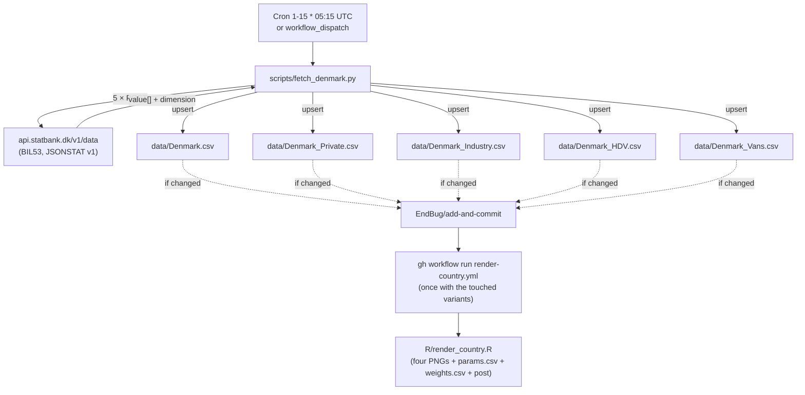
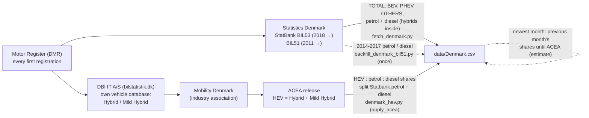

# 11 · Source: Denmark (api.statbank.dk / BIL53)

Statistics Denmark (Danmarks Statistik) publishes new-registration data
in StatBank table **BIL53** ("New registration of motor vehicles by
region, type of vehicle, terms of use, propellant and time") and exposes
it via a public JSON API at `https://api.statbank.dk/v1/data`. Compared
to the Netherlands pipeline this is straightforward — no session
handling, no saved templates, no pagination, one POST per variant.

## TL;DR

```
Source:    api.statbank.dk (table BIL53)
           Underlying data: Danmarks Statistik / Motorregistret
Auth:      None required
API:       POST https://api.statbank.dk/v1/data with JSON body
           (one request per variant; format=JSONSTAT)
Variants:  Whole, Private, Industry, HDV, Vans (5 separate CSV files)
HEV:       Not split by Statbank (folded into Petrol/Diesel upstream). A forward-only
           split of Whole by ACEA's shares is wired up (scripts/denmark_hev.py, §3)
           from 2026-11 on (the 2014–2017 gate is lifted, §12.5)
Backfill:  Pre-2018 Whole rows already in data/Denmark.csv; petrol/diesel
           2014–2017 from BIL51 (filled 2026-11-22)
Schedule:  Daily cron 1st–15th, 05:15 and 07:20 UTC; early-exit per variant once last month is in
Scripts:   scripts/fetch_denmark.py, scripts/denmark_hev.py,
           scripts/backfill_denmark_bil51.py (run once, 2026-11-22)
Workflow:  .github/workflows/fetch-denmark.yml
```

## 1. The API

`api.statbank.dk` is the official, public and documented REST endpoint
(<https://www.dst.dk/en/Statistik/hjaelp-til-statistikbanken/api>), no key. It accepts both
GET URLs with query parameters and POST with a JSON body — we use POST
because the body is easier to read in the script source than a
many-parameter URL.

The base discovery endpoint, `/v1/tableinfo/BIL53`, returns the full
list of valid dimension codes. Hit it any time the dimension layout
might have shifted:

```sh
curl -s 'https://api.statbank.dk/v1/tableinfo/BIL53?format=JSON&lang=en' \
  | python3 -m json.tool | less
```

Data requests look like:

```json
POST https://api.statbank.dk/v1/data
Content-Type: application/json

{
  "table":   "BIL53",
  "format":  "JSONSTAT",
  "lang":    "en",
  "variables": [
    {"code": "OMRÅDE",  "values": ["000"]},
    {"code": "BILTYPE", "values": ["4000101002"]},
    {"code": "BRUG",    "values": ["1000"]},
    {"code": "DRIV",    "values": ["20205","20210","20225","20232","20235", …]},
    {"code": "Tid",     "values": ["*"]}
  ]
}
```

Notes:

- The dimension code `OMRÅDE` contains a non-ASCII character (Å). Both
  Python's `requests.post(..., json=body)` and `curl --data` handle the
  UTF-8 encoding transparently; do **not** URL-encode it manually.
- `format: "JSONSTAT"` returns [JSON-stat v1](https://json-stat.org/format/).
  We use v1 not v2 because Statbank's v2 implementation seems incomplete
  (probe-testing returned an empty body for valid v2 requests).
- `lang: "en"` returns English labels. Codes are the same in both languages,
  so the script is unaffected; English just makes log output readable.

## 2. The five variants

| Variant | File | BILTYPE | BRUG | Notes |
|---|---|---|---|---|
| `Whole` | `data/Denmark.csv` | `4000101002` Passenger cars, total | `1000` Total | Default slice |
| `Private` | `data/Denmark_Private.csv` | `4000101002` | `1100` In households | |
| `Industry` | `data/Denmark_Industry.csv` | `4000101002` | `1200` In industries | |
| `HDV` | `data/Denmark_HDV.csv` | `4000103000` Lorries, total | `1000` | Pre-2021 cells are genuine zeros (see §4) |
| `Vans` | `data/Denmark_Vans.csv` | `4000102000` Vans, total | `1000` | |

Sanity check: `Private + Industry = Whole` per month. Verified against
random spot-checks across the full range; if a future fetch breaks this
invariant, Statbank changed the BRUG taxonomy.

`OMRÅDE = "000"` (All Denmark) is pinned for every variant. BIL53 also
exposes regional and per-municipality breakdowns; we don't use them.

### Why no `Road tractors` (BILTYPE `4000103030`) slice

The screen `BIL53 > Type of vehicle` lists `Road tractors, total` in
addition to `Lorries, total`. They are **disjoint** categories (Statbank
sums them into a fifth "Vehicles total" code, `4000100001`, so neither
is contained in the other). For Denmark we treat `HDV ≡ Lorries`, which
matches our other countries' HDV convention (heavy goods vehicles ≥ 3.5 t;
road tractors are a separate niche). Add a sixth variant if anyone wants
the road-tractor curve later.

## 3. Column mapping

Statbank propellant code (`DRIV`) → canonical CSV column:

| DRIV code | Statbank label | Canonical column |
|---|---|---|
| `20205` | Petrol | `PETROL` |
| `20210` | Diesel | `DIESEL` |
| `20225` | Electricity | `BEV` |
| `20232` | Pluginhybrid | `PHEV` |
| `20215` | LPG | `OTHERS` |
| `20220` | N-gas | `OTHERS` |
| `20230` | Kerosene | `OTHERS` |
| `20231` | Hydrogen | `OTHERS` |
| `20256` | Ethanol | `OTHERS` |
| `20258` | Ethanol | `OTHERS` |
| `20235` | Other propellant | `OTHERS` |
| (none) | — | `HEV` always blank — Statbank doesn't split full hybrids |

We deliberately ignore `DRIV=20200` ("Total propellant"). Our `TOTAL`
column is computed as the sum of the cells we actually wrote, which
guarantees `TOTAL = BEV+PHEV+PETROL+DIESEL+OTHERS` row-for-row (with an
HEV split: `TOTAL = BEV+PHEV+HEV+PETROL+DIESEL+OTHERS`).

Writes are **line-level** (AGENTS.md invariant 2, `upsert_csv`): a month
whose Statbank figures did not change keeps its line byte for byte, a
restated month is rewritten and keeps its HEV split
(`denmark_hev.carry_split`). Until 2026-11 the script round-tripped the
whole file through `csv.DictWriter` on every run and reset `HEV` to blank
on every row, which would have wiped any split. If
Statbank publishes a row where the breakdown doesn't sum to the
reported total, the script silently writes the breakdown sum (better
than disagreeing with the per-fuel cells).

### The Ethanol-x2 quirk

Statbank lists `Ethanol` **twice** under DRIV, with two different codes
(`20256` and `20258`). The labels are identical in both English and
Danish — the two codes appear to be E85 vs. ED95 (or two equally-marked
sub-categories), but Statbank does not expose the distinction in the
label text. For us both fold into `OTHERS`, so the ambiguity is moot.
If a future schema change splits them, `DRIV_TO_COL` in the script needs
no change.

### HEV: why Statbank cannot, and the prepared ACEA split

Statbank has **no code for non-plug-in hybrids** anywhere. BIL53 lists
`Pluginhybrid`; BIL51 lists `Hybrid/petrol` and `Hybrid/diesel`, but
those two add up to BIL53's `Pluginhybrid` in every month 2018-01 –
2026-10, i.e. they are the plug-ins (checked 2026-11-22). Full and mild
hybrids sit in `Petrol` and `Diesel`. The register behind it (DMR) can't
help either: its open weekly extract (a 7 GB zip, about 129 GB of XML)
marks a hybrid only through an electric consumption, which only plug-ins
have.

ACEA's Danish HEV is **Mobility Denmark's "Hybrid" + "Mild Hybrid"**
(bilstatistik.dk, from the same register): 25,128 in 2025 on both sides.
About three quarters of it are mild hybrids, and **about half of
Statbank's diesel are diesel mild hybrids** (2025: Statbank diesel 9,707,
Mobility Denmark pure diesel 4,774; Jan–Oct 2026: 7,108 vs 3,568). So,
unlike Finland, where every hybrid sits in StatFin's petrol, the split
takes hybrids out of petrol **and** diesel (`scripts/denmark_hev.py`):

```
pool    = Statbank petrol + Statbank diesel                (kept exactly)
HEV     = round(pool × ACEA HEV    / ACEA (HEV + petrol + diesel))
DIESEL  = round(pool × ACEA diesel / ACEA (HEV + petrol + diesel))
PETROL  = pool − HEV − DIESEL
```

TOTAL, BEV, PHEV and OTHERS stay Statbank's. A **share**, not ACEA's
count: ACEA's combustion pool runs 0.6–6.1% below Statbank's (a slightly
narrower scope, §12.4), and a count would push that gap into petrol.
Statbank's own petrol and diesel stay in the row's notes
(`[Statbank petrol N, diesel N]`), so the published figures are never
lost and a restatement is recognised. HEV means **full + mild hybrids**,
ACEA's definition, as for the Netherlands, Finland and Czechia.

| Step | When | `notes` start |
|---|---|---|
| ACEA's month (`fetch_acea.py` → `denmark_hev.apply_acea`) | ACEA's release, about the 22nd of the next month | `TOTAL/BEV/PHEV/OTHERS api.statbank.dk (BIL53); HEV/PETROL/DIESEL = Statbank petrol+diesel split by ACEA's …` |
| previous month's shares, **estimate** (`estimate_newest`, run by `fetch_denmark.py`) | Statbank's release (about the 10th) until ACEA's | `… HEV/PETROL/DIESEL estimated: Statbank petrol+diesel split by YYYY-MM's shares, until ACEA covers the month` |

ACEA's row must be Statbank's month: TOTAL within 1.5% (Feb 2026: 11,933
vs 12,059, 1.0%) and BEV within 2%. PHEV is not gated: the two count a few
dozen plug-ins differently (2026-04: 113 vs 119) and PHEV stays
Statbank's anyway. When ACEA's month lands, a later month estimated from
the old shares is re-estimated.

**Two gates keep it forward-only and harmless:**

- `HEV_FILL_FROM = "2026-11"`: only months after the CSV's last month when
  this was written. Nothing at or before 2026-10 is touched; a history
  estimate is a separate, owner-approved step (§12.5).
- `ready()`: no HEV is written while a Whole row has a TOTAL but neither
  petrol nor diesel — the 48 sheet rows 2014-01 – 2017-12 until their
  petrol/diesel were filled from BIL51 on 2026-11-22, so the gate is open.
  `build_series.py` stage 3 only turns a remainder into ICE when every
  electrified column of the file is present, so a single HEV row would
  drop those 48 months from the interactive series (154 → 106 points;
  pinned in `scripts/test_fetch_denmark.py`). Filling their petrol/diesel
  from BIL51 lifts the gate (§12.5).

Only `data/Denmark.csv` (Whole): ACEA has no Private / Industry split, so
hybrids stay inside petrol/diesel in the other variants. While HEV is
blank, the TTM stacked-shares plot has no HEV slice and the post text
drops the "(of which X%p were HEV)" line; the BEV/PHEV/ICE trajectory is
unaffected either way (ICE share is `(TOTAL − BEV − PHEV − EREV)/TOTAL`).

## 4. History and the HDV-2021 quirk

The `Tid` dimension exposes monthly data from `2018M01` onwards for the
table as a whole. **Per-variant** coverage differs:

| Variant | API range | After backfill |
|---|---|---|
| Whole | 2018-01 … current | **2014-01 …** current (see §5) |
| Private | 2018-01 … current | same |
| Industry | 2018-01 … current | same |
| Vans | 2018-01 … current | same |
| HDV | **2021-01 … current** | same |

For HDV, BIL53 cells before 2021-01 are reported as `0` — confirmed by
direct probes against the `20200` "Total propellant" code, not a
client-side filter artefact. Statbank only started tracking the Lorries
× propellant breakdown in 2021. Pre-2021 phantom-zero months are
filtered by the `to_csv_rows` skip-when-TOTAL=0 check.

## 5. Pre-2018 Whole history

`api.statbank.dk` only goes back to 2018-01 for the passenger-car
breakdown. The 48 Whole rows 2014-01..2017-12 are already in
`data/Denmark.csv` (BEV, PHEV, OTHERS, TOTAL from the maintainer's sheet;
petrol and diesel from StatBank BIL51, filled 2026-11-22 by
`scripts/backfill_denmark_bil51.py`, flagged in notes). Do not re-import them.
Petrol/diesel mean the same as from 2018: every non-plug petrol / diesel car,
full and mild hybrids included (BIL51's "Hybrid" codes are the plug-ins:
82 in all of 2014). Without those rows the Weibull `t0` would be 2018
instead of 2014. Private and Industry have no pre-2018 history.

## 6. Schedule and idempotency

`fetch-denmark.yml` runs **daily on the 1st–15th at 05:15 and 07:20 UTC**
(`cron: '15 5 1-15 * *'` and `'20 7 1-15 * *'`). Statbank publishes at
08:00 Copenhagen time (07:00 UTC in winter, 06:00 UTC in summer), so the
05:15 run always comes before the release and a release-day pickup
depended on GitHub's cron delay (the 2026 data commits landed between
06:42 and 13:08 UTC). The 07:20 run catches the release day itself.

- Statbank's BIL53 publication date varies — somewhere between the 9th
  and 12th of the following month, usually. Daily polling catches the
  new data on publication day.
- `previous_month_period()` + `csv_has_period_for_variant` short-circuit:
  once a variant's CSV has last month's row, that variant is skipped
  without any HTTP call. After day 15 the cron sleeps until the next
  month's 1st.
- 05:15 UTC keeps us clear of fetch-netherlands (06:30), fetch-brazil/
  fetch-acea (08:00), and the ACEA 03:17 UTC fallback.
- `--force` overrides the early-exit if Statbank ever restates an older
  month and you want it picked up the same day.

## 7. Workflow data flow



Where each figure of `data/Denmark.csv` (Whole) comes from. TOTAL, BEV,
PHEV and OTHERS are always Statistics Denmark's; the hybrid split only
borrows **shares**, and those shares are DBI IT's classification of the
same register (via Mobility Denmark and ACEA), since the register itself
cannot tell a non-plug hybrid from a petrol or diesel car (§3).



## 8. Parallel-render push race (one-time stumble)

The first time `fetch-denmark.yml` ran, it dispatched five
`render-country.yml` runs back-to-back. The render workflow's
concurrency group is keyed by `country-variant`, so different variants
run in parallel — and each ends with a `git push` to the same branch.
Two of the five renders raced and got `[remote rejected] (cannot lock
ref … is at X but expected Y)` from the push.

This was resolved by serially re-dispatching the failed variants. The
race is rare in practice: monthly publication only produces five
near-simultaneous touched variants on the day BIL53 publishes; on every
other day the early-exit short-circuit means at most one variant gets
touched. If we want to remove the race entirely, switch the dispatch
loop to `gh workflow run ... && gh run watch <id>` so renders serialise
end-to-end — adds ~10 minutes to a once-monthly run, deemed not worth
it for now.

## 9. Known fragility

| Failure mode | What happens | Diagnostic |
|---|---|---|
| Statbank deprecates BIL53 or restructures its dimensions | POST returns 4xx, or the parser sees unfamiliar dimension IDs | Hit `/v1/tableinfo/BIL53?lang=en`, compare to the codes in `VARIANT_CONFIG` and `DRIV_TO_COL`, update accordingly |
| New DRIV code (e.g. a new alt-fuel) | Script raises `RuntimeError("unmapped DRIV code …")` and aborts before commit | Add the new code to `DRIV_TO_COL` (almost always under `OTHERS`) |
| Statbank restates an older month with >50% delta | Upsert prints `WARNING` to the action log but still commits the new values | Manually verify and revert with a CSV edit if not real |
| `OMRÅDE` URL/JSON encoding regresses in some HTTP client | API returns 400 / empty dataset | Stick with `requests`; the script passes the body via `json=` so encoding is automatic |
| ACEA's Danish row isn't Statbank's month (TOTAL off by >1.5% or BEV by >2%) | `Denmark YYYY-MM: ACEA HEV not merged` in the fetch-acea log; the month keeps its estimate | Compare the two by hand; if ACEA changed scope, widen the gate in `denmark_hev.py` with a note |
| HEV split never appears | `Denmark: HEV split waits — 48 Whole rows …` in both logs | Was expected until the BIL51 fill; since 2026-11-22 a Whole row with TOTAL but no petrol/diesel is new — find where it came from |

## 10. Maintenance recipes

### Add a sixth variant (e.g. Road tractors, Buses)

1. Look up the BILTYPE code via `/v1/tableinfo/BIL53` (the screen lists
   five BILTYPE values today).
2. Add an entry to `VARIANT_CONFIG` in `scripts/fetch_denmark.py` with
   the BILTYPE / BRUG / output-path combination.
3. Add the variant name to the `--variant` choices in the script and
   to the `render-country.yml` choice list.
4. Add a flag asset at `assets/flags/denmark_<variant>.png`.
5. Update this doc's variant table (§2).

### Force-refetch an older month (Statbank restated something)

```sh
python scripts/fetch_denmark.py --variant whole --force
```

### Validate the API by hand

```sh
curl -s -X POST 'https://api.statbank.dk/v1/data' \
  -H 'Content-Type: application/json' \
  -d '{"table":"BIL53","format":"JSONSTAT","lang":"en","variables":[
    {"code":"OMRÅDE","values":["000"]},
    {"code":"BILTYPE","values":["4000101002"]},
    {"code":"BRUG","values":["1000"]},
    {"code":"DRIV","values":["20225","20232"]},
    {"code":"Tid","values":["2026M03","2026M04"]}
  ]}' | python3 -m json.tool | head -40
```

Should return a `dataset.value` array of four numbers (BEV + PHEV × two
months) matching the Statbank UI at
<https://www.statbank.dk/statbank5a/SelectVarVal/Define.asp?MainTable=BIL53>.

## 11. What is **not** in this pipeline

- Authentication. The API is fully open. Don't add a Statbank API key —
  there isn't one.
- Sub-monthly data. BIL53 is published monthly, around the 10th of the
  following month. There's no daily or quarterly endpoint we use.
- Regional breakdowns. The full municipal hierarchy is in BIL53 but we
  pin `OMRÅDE = "000"` (All Denmark) to keep the CSV count manageable.
- Backfill for Private / Industry / HDV / Vans before the API range.
  The maintainer's sheet doesn't have those slices that far back. Add
  them to the sheet first if needed; the backfill script is then a
  ~20-line extension.

## 12. Source review 2026-11 (is this the primary source?)

Checked 2026-11-22 for the owner's question: does Denmark already use the
primary source, and can it be faster, more accurate and include HEV?

### 12.1 Verdict

**Yes, Statbank is the right primary source; no switch.** BIL53 is
Statistics Denmark's official statistic of the Motor Register (DMR), on a
documented public API, with the Private/Industry/Vans/HDV slices nobody
else publishes openly. Every 2018–2026 cell of all five CSVs equals
today's API exactly (a forced re-fetch changed no byte). What it lacks is
the hybrid split, and a day or so of pickup speed.

### 12.2 Candidates

| Source | Official / licence | Lag after month end | Powertrain split | History | Machine access | Verdict |
|---|---|---|---|---|---|---|
| **Statbank BIL53** (used) | Statistics Denmark, official; free reuse with attribution | ~9–13 days (Oct 2026: 13 Nov, 08:00 CET) | BEV, PHEV, petrol, diesel, 7 other codes; **no HEV** | 2018-01 → | documented API, no key | keep |
| **Statbank BIL51** | same | same day as BIL53 | same as BIL53 (its "Hybrid/petrol"+"Hybrid/diesel" = plug-ins); Total/Households/Industries | **2011-01 →** | same API | use for 2014–2017 petrol/diesel (§12.5) |
| DMR open extract (Motorstyrelsen) | official register; free, "not for business-critical use" | weekly snapshot | per-vehicle fuels; a hybrid shows only via electric consumption, so **no HEV** | snapshot, no archive | FTP, ~7 GB zip / ~129 GB XML | no: no HEV, too heavy for CI |
| Mobility Denmark (bilstatistik.dk data) | industry association; figures may be passed on only with reference to bilstatistik.dk | **day 1** press release; statistics page on day 1–2 | press release: total + BEV in prose; page: BEV, PHEV, **Hybrid, Mild Hybrid**, petrol, diesel, hydrogen — **year-to-date only** in the HTML | page: current year | no API; monthly/period views only via the site's `wp-admin` AJAX, which robots.txt disallows | not as a feed; YTD page used as cross-check |
| ACEA monthly release | ACEA, relays Mobility Denmark | ~22nd–25th of next month | BEV, PHEV, **HEV (full + mild)**, petrol, diesel, others | 2023-11 → as PDFs (some months missing), quarterly XLSX 2014–2022 | public PDF, parser in `fetch_acea.py` | use for the HEV shares (§3) |
| bilstatistik.dk | commercial (DBI-IT) | — | — | — | paid | no |

### 12.3 Faster

Statbank's ~10-day lag is the floor for an official, complete row. The
07:20 UTC run (§6) removes the remaining release-day risk. Mobility
Denmark's day-1 press release would be ~10 days earlier but gives only
TOTAL and BEV as free text whose wording varies from month to month, and
its scope is ACEA's, 0.1–1.0% below Statbank's. Not proposed as a feed.

### 12.4 Reconciliation (Statbank BIL53 vs ACEA vs Mobility Denmark)

Monthly, ACEA's release vs the CSV (ACEA has no July release):

| Month | TOTAL SB | TOTAL ACEA | Δ | BEV SB | BEV ACEA | Δ | PHEV SB | PHEV ACEA | Petrol+diesel SB | HEV+petrol+diesel ACEA | Δ | HEV ACEA | HEV by §3 | Diesel SB → split |
|---|---|---|---|---|---|---|---|---|---|---|---|---|---|---|
| 2025-10 | 16,172 | 16,156 | -0.1% | 11,392 | 11,405 | +0.1% | 309 | 306 | 4,471 | 4,445 | -0.6% | 2,554 | 2,569 | 985 → 489 |
| 2025-11 | 15,937 | 15,908 | -0.2% | 11,721 | 11,730 | +0.1% | 252 | 252 | 3,964 | 3,926 | -1.0% | 2,094 | 2,114 | 839 → 351 |
| 2025-12 | 18,525 | 18,475 | -0.3% | 14,948 | 14,955 | +0.0% | 437 | 420 | 3,140 | 3,100 | -1.3% | 1,808 | 1,831 | 703 → 292 |
| 2026-01 | 12,874 | 12,802 | -0.6% | 10,609 | 10,618 | +0.1% | 141 | 142 | 2,123 | 2,042 | -3.8% | 1,264 | 1,314 | 406 → 240 |
| 2026-02 | 12,059 | 11,933 | -1.0% | 9,727 | 9,736 | +0.1% | 122 | 122 | 2,208 | 2,073 | -6.1% | 1,165 | 1,241 | 675 → 397 |
| 2026-03 | 19,068 | 18,968 | -0.5% | 14,603 | 14,616 | +0.1% | 147 | 147 | 4,318 | 4,205 | -2.6% | 2,700 | 2,773 | 844 → 344 |
| 2026-04 | 16,835 | 16,754 | -0.5% | 13,715 | 13,721 | +0.0% | 119 | 113 | 3,001 | 2,920 | -2.7% | 1,655 | 1,701 | 826 → 361 |
| 2026-05 | 19,174 | 19,092 | -0.4% | 15,018 | 15,020 | +0.0% | 99 | 98 | 4,057 | 3,974 | -2.0% | 2,265 | 2,312 | 828 → 454 |
| 2026-06 | 21,582 | 21,486 | -0.4% | 16,990 | 16,996 | +0.0% | 85 | 84 | 4,507 | 4,406 | -2.2% | 2,653 | 2,714 | 1,059 → 606 |
| 2026-08 | 16,217 | 16,165 | -0.3% | 13,875 | 13,887 | +0.1% | 18 | 20 | 2,324 | 2,258 | -2.8% | 1,461 | 1,504 | 731 → 377 |
| 2026-09 | 20,063 | 20,025 | -0.2% | 17,777 | 17,784 | +0.0% | 22 | 23 | 2,264 | 2,218 | -2.0% | 1,427 | 1,457 | 599 → 282 |

All eleven months pass the §3 gates. The gap is almost entirely in
combustion cars: Mobility Denmark/ACEA count slightly fewer of them, BEV
agrees within 0.1%.

Yearly, Mobility Denmark's statistics page (archived YTD snapshots) vs
the CSV:

| Period | TOTAL SB | TOTAL MD | BEV SB | BEV MD | PHEV SB | PHEV MD | Petrol+diesel SB | MD petrol / diesel / Hybrid / Mild Hybrid | Hybrids of TOTAL (MD) | Mild share of hybrids |
|---|---|---|---|---|---|---|---|---|---|---|
| 2024 | 173,437 | 173,047 (-0.2%) | 89,037 | 89,140 | 7,067 | 7,091 | 77,333 | 39,904 / 7,044 / 8,951 / 20,917 | 17.3% | 70% |
| 2025 | 185,395 | 184,638 (-0.4%) | 126,410 | 126,539 | 4,826 | 4,692 | 54,131 | 23,477 / 4,774 / 6,258 / 18,870 | 13.6% | 75% |
| 2026 Jan–Oct | 171,453 | 170,660 (-0.5%) | 140,656 | 140,727 | 806 | 800 | 29,988 | 7,757 / 3,568 / 3,920 / 13,886 | 10.4% | 78% |

ACEA's 2025 HEV (sum of its monthly releases, 25,128) equals Mobility
Denmark's Hybrid + Mild Hybrid (6,258 + 18,870) exactly.

History before 2018 (Whole): the 48 sheet rows' TOTAL, BEV and PHEV equal
BIL51 in every month; OTHERS is a few cars below BIL51's in 22 months
(at most 28 cars, 2017-09).

### 12.5 Proposals (not in this pipeline yet; each needs the owner's yes)

1. **Done 2026-11-22.** Petrol/diesel for 2014-01 – 2017-12 from BIL51
   (`python scripts/backfill_denmark_bil51.py --write`; dry run without
   `--write`). Fills only blank cells, only where BIL51's TOTAL/BEV/PHEV
   equal the row, flags each row in notes; TOTAL/BEV/PHEV/OTHERS untouched.
   Official figures, not an estimate. This lifts the `ready()` gate. Open
   choice: also correct OTHERS to BIL51's in the 22 months (≤28 cars) so
   the rows sum exactly — that changes existing values, so it was not done.
2. **HEV history estimate** in the NL/FI/CZ pattern, so the TTM shows
   hybrids over the whole span instead of starting late: ACEA's monthly
   shares 2023-11 → (the unmerged `feat/acea-hev-split` branch already
   parses those PDFs), ACEA's quarterly shares 2018–2022
   (`reference/acea_country_quarterly.csv`). Caveat: ACEA's Danish HEV
   jumps from ~2,000 to ~7,700 a quarter at 2022-Q1, which looks like mild
   hybrids entering ACEA's Danish count then; before 2022 it is probably
   full hybrids only. Needs a decision on that seam before any estimate.
3. **Extend Whole back to 2011-01 from BIL51** (36 more months, full
   propellant split). Changes the fitted curve's start; render check
   needed.
4. **MHEV separately**: Mobility Denmark splits Hybrid vs Mild Hybrid, but
   only year-to-date on a page without an allowed monthly view. Stay on
   ACEA's HEV definition (full + mild) like NL/FI/CZ unless a clean source
   appears.
5. After 1 (and ideally 2): set `hev_split`/`hev_note` once the first
   HEV month is in the CSV, and dispatch the Denmark render. The Denmark
   Whole footnote is in (2026-11-22): it says hybrids sit in petrol/diesel
   and that HEV is split out from Nov 2026, so petrol and diesel step down
   there by definition, not by market.
