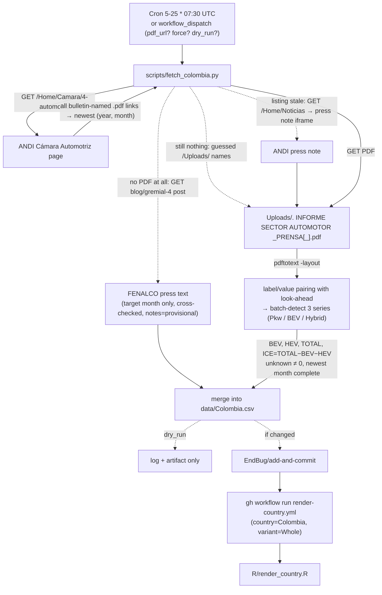

# 18 · Source: Colombia (ANDI/FENALCO Boletín — datos RUNT)

The joint **FENALCO + ANDI** monthly *Informe del Sector Automotor* PDF
(linked from ANDI's Cámara Automotriz page) is Colombia's accessible window
on the same data that powers ANDEMOS's gated dashboards: the underlying
figures come from **RUNT** (Registro Único Nacional de Tránsito — Colombia's
official vehicle registry). ANDI/FENALCO simply re-publishes the registry's
monthly aggregate as a free, public PDF.

This unblocks Colombia from the earlier "shelved" status (see
[14-data-source-gaps.md](14-data-source-gaps.md)): no login required, no
embedded dashboards to scrape, just a monthly PDF.

## TL;DR

```
Source:    ANDI Cámara Automotriz — joint with FENALCO, "Informe del Sector
           Automotor" PDF. Underlying data: RUNT (official Colombian registry).
Auth:      None — public PDF download.
API:       Discovery via the Cámara Automotriz HTML, then ANDI's press note
           for the month (embedded PDF), then a reconstructed /Uploads/ URL;
           PDF parsed with `pdftotext -layout` (poppler). If no PDF is
           reachable: FENALCO's public press text for the month (provisional
           row, § 2 "FENALCO press-text fallback").
Variants:  Whole only = the bulletin's "vehículos nuevos" total: every new
           four-wheel vehicle (SUV, automóviles, pick-ups, camionetas,
           taxis, vans, comerciales de pasajeros / de carga, cuadriciclos).
           NOT passenger cars only — see § 3a. Motorcycles excluded.
HEV split: NONE. "Híbridos" is a single combined bucket (HEV+PHEV+MHEV
           unsplit). → Türkiye/Georgia convention: combined hybrids go in
           the HEV column, labelled "Hybrid" in posts. PHEV is left empty.
ICE:       Reported as a derived residual: ICE = TOTAL − BEV − HEV.
           PETROL/DIESEL/FLEXFUEL/OTHERS are not separately reported.
History:   Each PDF carries ~31 months of monthly series (the Jul-2026
           boletín → 2024-01 … 2026-07). Older history via the annual
           "INFORME … A DICIEMBRE YYYY" PDFs (2018-2024) or maintainer's
           own backfill (the CSV runs from 2019-01).
Schedule:  Daily cron 5th–25th, 07:30 UTC; early-exit once last month is in.
Scripts:   scripts/fetch_colombia.py  (+ scripts/test_fetch_colombia.py)
Workflow:  .github/workflows/fetch-colombia.yml
           (inputs: pdf_url, force, dry_run, dump_listing)
```

## 1. Why ANDI/FENALCO (and not ANDEMOS or RUNT directly)

- **RUNT** is the official source of truth, but its open-data portal is
  account-gated (signup wall) — see [14-data-source-gaps.md § Colombia](14-data-source-gaps.md).
- **ANDEMOS** publishes the same data via embedded Google Looker Studio
  dashboards (no clean download/API).
- **ANDI Cámara Automotriz** publishes a **joint FENALCO+ANDI boletín** as a
  free PDF every month, *also sourced from RUNT*. Same numbers, no wall.
  FENALCO mirrors the same report on `fenalco.com.co/blog/gremial-4/…`. Its
  PDF button sits behind `web/login`, but the post **text** is public and
  states the month's total, electric and hybrid counts — enough for a
  provisional row when the PDF itself cannot be reached (§ 2, "FENALCO
  press-text fallback").

The PDF carries less granularity than ANDEMOS's interactive dashboards
(combined hybrids only), but it has enough for the gallery's BEV/Hybrid/ICE
trajectory.

## 2. The endpoint and discovery

There is no REST endpoint. We:

1. GET the Cámara Automotriz page:
   `https://www.andi.com.co/Home/Camara/4-automotriz`
2. Take **every `href` ending in `.pdf`**, URL-decode + HTML-unescape it, and
   keep those whose basename contains `INFORME`, `SECTOR` and `AUTOMOTOR`.
3. Read the month from the first Spanish month token in the name
   (abbreviated `ENE…DIC`, four-letter `SEPT`, or full `ENERO…DICIEMBRE`) and
   the year from the first standalone four-digit `20YY`. The leading numeric
   prefix (`07.`) is only cross-checked — a mismatch is printed, the month
   token wins.
4. Sort by (year, month) descending, a monthly `_PRENSA` file above an
   annual `A DICIEMBRE` file for the same month; pick the first.
5. If that first candidate is **older than the month we came for**, look for
   the PDF embedded in ANDI's press note for the month, then reconstruct the
   month's `/Uploads/` URL — see "When the listing stopped carrying
   monthlies" below.
6. Download the PDF and run `pdftotext -layout` on it.
7. If no leg produced a PDF for the month, fall back to FENALCO's press text
   — see "FENALCO press-text fallback" below.

### Filename shapes seen so far

ANDI renames the file more or less every year. Discovery deliberately does
**not** pin a template — that is exactly what broke in 2026:

| Year | Example basename (decoded) |
|---|---|
| 2021 | `06. INFORME SECTOR AUTOMOTOR JUNIO 2021_PRENSA.pdf` |
| 2025 | `12. INFORME SECTOR AUTOMOTOR DIC_PRENSA-INDUSTRIA 2025_639034007525631477.pdf` |
| 2026 | `02. INFORME SECTOR AUTOMOTOR FEB2026_PRENSA.pdf`, `07. INFORME SECTOR AUTOMOTOR JUL2026_PRENSA_639237910436235821.pdf` |
| annual | `INFORME DEL SECTOR AUTOMOTOR A DICIEMBRE 2024.pdf` (different layout, backfill only) |

The `<ticks>` suffix is a per-upload .NET timestamp, present on some uploads
and not others; hrefs come both `%20`-encoded and with literal spaces, and
sometimes as absolute `https://andi.com.co/...` URLs.

### When the listing stopped carrying monthlies (Sept 2026)

Between 2026-09-02 and 2026-09-05 ANDI rewrote the
`#boletinesdelsectorautomotor` tab from a monthly list into a **year-end
archive**: eight links, `INFORME FINAL SECTOR AUTOMOTOR 2018…2025`, and
nothing monthly newer than the Dec-2025 file (now relabelled as the 2025
year-end report). The whole page carries 34 `.pdf` hrefs, of which exactly 8
name AUTOMOTOR — all of them annual. Since we parse the raw HTML, every tab
pane is already in view: nothing is hidden behind the tab UI, the monthlies
are simply gone from the page.

**The PDFs themselves were not withdrawn.** Every 2026 monthly still answers
at its original `/Uploads/` path:

| Month | Constructed URL (`08. INFORME SECTOR AUTOMOTOR AGO2026_PRENSA.pdf` shape) |
|---|---|
| Ene 2026 | 404 (uploaded under some other name) |
| Feb–Jun 2026 | 200, ~1.40 MB each |
| Jul 2026 | 200 but **0 bytes** — the real Jul file is the ticked one |
| Ago 2026 | 200, 1,397,788 B |
| Sep 2026 | 404 (not published yet — correct, it is due in October) |

So discovery now has **three legs** (`resolve_bulletin`):

1. scrape the listing as before (still the source for annuals/backfill, and
   for monthlies if ANDI ever restores them);
2. if the newest listed bulletin is older than the month we came for, read
   ANDI's press notes (`find_in_andi_news`): the listing
   `https://www.andi.com.co/Home/Noticias` links notes as
   `/Home/Noticia/<id>-<slug>` with the slug cut at ~40 characters
   (`18083-andi-y-fenalco-en-agosto-de-2026-se-reg`). The up to 8 newest
   notes whose slug mentions fenalco / automot / vehicul / matricul are
   opened, and every `href`/`src` ending in `.pdf` that classifies as exactly
   the wanted month is tried. The Aug-2026 note embeds its boletín as
   `<iframe src="…/Uploads/08.%20INFORME%20SECTOR%20AUTOMOTOR%20AGO2026_PRENSA.pdf">`;
   the motorcycle note next to it (`…Informe Motocicletas…`) does not
   classify. This is the only leg that can find a name with a `<ticks>`
   suffix, which no guess can produce;
3. reconstruct that month's `/Uploads/` URL from the shapes above
   (`monthly_url_candidates`, 2026 shape first; for September also `SEPT`
   and `SET`) and take the first that is really that PDF.

URL construction is only safe because of what checks it, so do not weaken
either guard:

- a candidate counts only if it answers **200 and its body starts with
  `%PDF`** — the Jul-2026 0-byte URL is exactly why a status check alone is
  not enough;
- a URL from legs 2 or 3 must then parse to a series ending on exactly the
  month requested, or the run aborts (`SystemExit`) rather than upsert one
  month's numbers under another month's label. A URL from the Cámara listing
  only warns.

### FENALCO press-text fallback (Oct 2026)

The September 2026 boletín was not reachable at all: no Cámara link, no ANDI
press note (the newest automotive note on 2026-10-24 was still August's), and
every `/Uploads/` shape answered 404. FENALCO had published the month on
1–3 October. Its post keeps the PDF behind `web/login`, but the post body is
public and carries the three figures we ingest, from the same RUNT extract:

> Durante septiembre se registraron **33.835 vehículos nuevos** … Para el
> caso de los eléctricos, … con **5.895 unidades** matriculadas … los
> híbridos … con **11.261 unidades** …

Backtest: the July and August 2026 posts give exactly the CSV's boletín
values (28,633 / 4,870 / 9,410 and 27,124 / 4,542 / 9,195).

`fenalco_fallback` runs only when no PDF for the target month was found:

1. GET `https://www.fenalco.com.co/blog/gremial-4` and look for
   `/blog/gremial-4/informe-del-sector-automotor-a-<mes>-<yyyy>-<id>`
   (`informe-del-sector-motocicletas-…` never matches). No post → the month
   is not published yet; the usual day-20 rule applies (below).
2. Parse the post body only (`#o_wblog_post_content` up to
   `#o_wblog_post_footer`), and require "Informe de Registro de Vehículos a
   <mes> de <yyyy>" in it. TOTAL comes from "(En|Durante) <mes> [de <yyyy>]
   se (registraron|matricularon) N vehículos nuevos" — the YTD sentence
   ("Entre enero y septiembre … 247.212") never matches. BEV and Hybrid come
   from sentences that name "eléctric…" or "híbrid…" (not both) and give
   "N unidades". Every hit for a figure must agree; none, or two different
   ones, fails the run ("wording not recognised").
3. Cross-check: parse the **previous** month's post the same way and compare
   with the CSV row for that month (from a boletín). Any figure more than 1 %
   off — or no previous row to compare with — fails the run.
4. Upsert the **target month only**: `source` unchanged, `notes` =
   `fenalco press text - provisional until the ANDI/FENALCO PDF is reachable`,
   ICE = TOTAL − BEV − HEV as usual. A boletín row for the month is never
   replaced by press text.

A provisional row does **not** satisfy the early exit (`csv_has_final_period`),
so the daily runs keep searching for the PDF (re-applying the same text is a
no-op, nothing is committed). The first boletín that carries the month —
its own or any later one, each re-carries ~31 months — overwrites the row and
clears the note (`merge_row` takes the new row's `source`/`notes`).

**Fail early.** Once FENALCO lists the month, "not published yet" is no
longer an excuse: if the post cannot be parsed or the cross-check fails, the
run goes red with `::error title=Colombia <month> published but not
ingestible::` on any day, instead of waiting for day 20. If FENALCO's index
itself cannot be reached the run only warns and falls through to
`require_target_month`. `--no-fenalco-fallback` switches the leg off for
local debugging.

When the fallback fires, check the post by hand once: the patterns are tight
but the wording is a press office's, not a data format.

### The 2026 stall (postmortem)

From January to September 2026 the scheduled run was **green every day and
fetched nothing**: the old regex required `<MMM>_PRENSA-INDUSTRIA <YYYY>_<ticks>`,
the 2026 files are `<MMM><YYYY>_PRENSA…`, so the only match on the page
was the Dec-2025 file, which the run re-read and "updated" (33 rows, no
change) daily. Two side effects made it worse than a plain failure:

- the early-exit never triggered (the previous month was never in the CSV),
  so the stale PDF was re-applied on every run;
- the same-line-only value regex missed a few bars in that PDF, those months
  came back as BEV=0, and the upsert wrote the 0 over two cells the
  maintainer had corrected by hand (2023-11, 2025-07).

Guards now exist for this class of failure: discovery prints both the
candidate list it accepted **and** the `.pdf` links it rejected; the merge
rule in § 4a never lets an unknown or a parsed 0 replace an existing value;
and `require_target_month` (below) stops the run from reporting success
when it did not reach the month it came for.

### The September 2026 repeat (postmortem)

The same silent-green shape, a different cause, and it went unnoticed for
three weeks (2026-09-02 → 2026-09-19): the tab rewrite above left Dec-2025 as
the newest listed bulletin, discovery duly picked it, re-read the 36 months it
already had, committed nothing and exited **0**.

The freshness guard added after the first stall did fire — every run printed
`::warning:: Newest bulletin on the Cámara page is 2025-12 but the CSV already
runs to 2026-07` — and it changed nothing, because a warning on a **passing**
run is a warning nobody receives. The schedule looked healthy the whole time.

So the rule is now stated in terms of the month the run exists for, and it
fails:

- `require_target_month(wanted, got)` compares the month we came for
  (`previous_month_period()`) against the best month we could actually reach.
- Before day `PUBLICATION_GRACE_DAY` (20) a miss is ordinary — ANDI publishes
  over the first ~3 weeks — so the run exits 0 saying "probably not published
  yet".
- On or after day 20 the month is overdue, so the run **fails** with an
  `::error::` naming the month and pointing at `dump_listing=true`.

The lesson generalises beyond Colombia: a fetcher whose source has quietly
moved must go red, not green-with-a-warning. If you add a staleness check to
another fetcher, make it exit non-zero.

## 3. The PDF and what we extract

Each monthly boletín (~18 pages) contains, near the back, **three bar
charts emitting one bar per month** for the previous ~31 months:

- **Total new vehicles** monthly (the "Vehículos Nuevos" historical chart —
  all types, see § 3a; not passenger cars only).
- **Vehículos eléctricos** (BEV) monthly.
- **Vehículos híbridos** (combined HEV+PHEV+MHEV) monthly.

A fourth chart, **Vehículos de transporte de carga**, repeats the
*Comerciales Carga* line of the type table (Aug 2026: 755 in both). Those
vehicles are already **inside** the total above; the chart is ignored because
it adds nothing, not because cargo is excluded.

### 3a. What TOTAL includes (vehicle scope)

The bulletin's "Registros por tipo de vehículo" table splits the month's
total by type. Aug 2026 (sums exactly to the 27,124 we publish):

| Tipo de vehículo | Aug 2026 |
|---|---:|
| SUV | 17,929 |
| Automóviles | 5,666 |
| Pick Ups | 1,666 |
| Comerciales Carga | 755 |
| Taxis | 410 |
| Camionetas | 375 |
| Comerciales Pasajeros | 260 |
| Vans | 56 |
| Cuadriciclos | 7 |
| **Total matrículas** | **27,124** |

So `TOTAL` is **all new four-wheel registrations** (motorcycles have their
own report), not "automóviles" and not an M1-only passenger-car figure.
Earlier versions of this page said "passenger cars (automóviles)"; that was
wrong. FENALCO's press text calls the same number "vehículos nuevos".

The narrower, M1-like reading (SUV + Automóviles + Camionetas + Taxis ≈
24,380, ~90 %) is **not** cleanly available:

- the type table exists only for the bulletin's own month and the same month
  a year earlier (plus year-to-date), not as a monthly history;
- **BEV and Hybrid are published only over the whole total** — there is no
  per-type electric or hybrid figure anywhere in the bulletin or the press
  text. A car-only TOTAL with all-type BEV/HEV would mix scopes and overstate
  the shares (electric pick-ups and vans would count in the numerator only).

Hence the series stays on the wider total, consistently for TOTAL, BEV and
HEV, and the source page states the scope. Narrowing it would need a source
with fuel by vehicle class (RUNT open data, ANDEMOS — both gated, see
[14-data-source-gaps.md](14-data-source-gaps.md)).

`pdftotext -layout` linearises each bar's `mes-AA  value` label. The parser
walks the text line by line, pairs every month label with its value, then
**groups the pairs into batches by (year, month) reset** — each chart emits
its bars chronologically, so a month-year smaller than the previous one
signals a new chart.

Order in the boletín is: Total → BEV → Hybrid → Carga (we use the first
three, by position). This is more robust than parsing chart titles, which
vary in capitalisation/whitespace. A magnitude check (the first batch must
have the largest peak) fails the run if the order ever changes.

### Where the value sits

Normally on the label's line: `may-26   28.136`. For a few bars per chart
(mar-25, jul-26 in the BEV chart of the Jul-2026 file; ene-25 in the Hybrid
chart …) pdftotext emits the label alone and the value **six lines further
down**, behind blank lines and stray chart-title fragments:

```
                               jun-26                        4.935
                                jul-26
Variación acumulada : 231,2%


                                                              4.870
^L                                        0
```

`_value_for_label` takes the first number to the right of the label on the
same line, otherwise scans up to `VALUE_LOOKAHEAD_LINES` (12) lines below for
a **number-only** line with a number **right of the label column**, stopping
at the next month label or a form feed (page break = next chart). Axis ticks
only occur at the top of a chart, after the form feed; the `231,2%` line has
letters and a `%` and is skipped.

The year-to-date totals are the real trap, and the two layouts place them
differently. In the 2026 files they sit at column ~11, left of the labels at
~31, so the column rule excludes them. In the 2025 files they sit **right**
of the labels, on the line straight after an orphan label, with the real bar
value five lines further down:

```
                                          ene-24
                                                                        186.222      ← YTD (Ene-dic 2023)


                                                   11.581                            ← the bar
                                                                     (Ene-dic 2023)
```

What identifies the YTD total in both layouts is its caption: `(Ene-dic
2023)` / `(Ene-jul 2026)` appears a few lines *below* the number at (almost)
the same column, because both live in the same text box. `_is_ytd_total`
looks `YTD_CAPTION_LOOKAHEAD_LINES` (8) lines down for a `(Ene-` caption
within `YTD_CAPTION_COLUMN_TOLERANCE` (8) columns and the candidate is
skipped. As a layout-independent backstop, `_drop_outliers` then removes any
month whose value exceeds `OUTLIER_FACTOR` (3×) the larger of its two
neighbours — a YTD total is 6–12× a monthly bar, a genuine month-on-month
jump in this market has never been 3× — and reports it as unknown.

Both real bulletins are the acceptance test: the Jul-2026 file must yield
4 × 31 months (2024-01 … 2026-07), the Dec-2025 file 4 × 36 months
(2023-01 … 2025-12), each with every overlapping value equal to the CSV.
`test_fetch_colombia.py` carries the verbatim snippets of both traps.

### Spanish number format

Counts use **`.` as thousands separator** (`14.558` → 14558). No decimals in
counts. `parse_value(s) = int(s.replace(".", ""))`.

## 4. Column mapping (Türkiye / Georgia "single Hybrid bucket" convention)

| Source line | Canonical column |
|---|---|
| Vehículos eléctricos | `BEV` |
| Vehículos híbridos *(combined, no PHEV split)* | `HEV` (labelled "Hybrid" in posts) |
| (TOTAL − BEV − HEV) | `ICE` |
| TOTAL "vehículos nuevos" (all types, § 3a) | `TOTAL` |
| — | `PHEV`, `PETROL`, `DIESEL`, `FLEXFUEL`, `OTHERS` all empty |

If ANDEMOS/RUNT ever start publishing the PHEV split in a free format, the
parser can be extended; until then the combined Hybrid bucket is the cleanest
representation. See [09-glossary.md § Variant definitions](09-glossary.md) for
the convention.

### 4a. Merge rules — unknown is not 0

`assemble_rows` leaves a cell `None` when a chart has no readable value for
a month. `merge_row` then decides per month:

| Parsed | CSV has | Result |
|---|---|---|
| value | nothing | row added |
| value | value | row updated (warning if a count moves by >50 %) |
| `None` | value | CSV value kept, `ICE` recomputed |
| `0` | non-zero value | CSV value kept, warning — a 0 over a real count is the parser gap in disguise |
| `None` | nothing | month **skipped** with a warning — a gap in the chart is honest, BEV=0 is not |

The **newest month in the PDF must be complete** (TOTAL, BEV and HEV all
read); otherwise the run fails with a pointer to `--dump-text`. That is the
month the whole run exists for, and it is also the bar most likely to be
displaced in the text.

## 5. Schedule and idempotency

`fetch-colombia.yml` runs **daily on the 5th–25th at 07:30 UTC**
(`cron: '30 7 5-25 * *'`). ANDI/FENALCO usually publishes the previous
month's boletín within the first three weeks of the following month — the
21-day polling window covers it comfortably. The `previous_month_period()` +
`csv_has_period` short-circuit makes runs after capture a no-op until the
next month's window opens. Because every bulletin re-carries ~31 months,
each successful read also absorbs any upstream revision of recent months.

Workflow inputs (all `workflow_dispatch` only):

| Input | Effect |
|---|---|
| `pdf_url` | Skip discovery, parse this PDF (backfill from an older bulletin on the same page). |
| `force` | Re-read the newest bulletin even if the previous month is already in the CSV. |
| `dry_run` | Discover + download + parse, print the candidate list, the batches and the would-be changes, dump the full `pdftotext -layout` text into the log — **write nothing, commit nothing**. The PDF and its text are also uploaded as the run artifact `colombia-bulletin` (7 days). |

`dry_run` is the tool for any parser or discovery work: the ANDI host is not
reachable from every sandbox, and a green run on a branch against the real
PDF is worth more than a fixture.

07:30 UTC sits clear of the existing cron crowd (03:17 / 04:00 / 04:40 /
05:15 / 05:50 / 06:30 / 08:00 / 09:00 / 10:00 / 11:00 / 12:00 / 13:00 /
17:30 / 20:30).

## 6. Workflow data flow



Single variant ⇒ no parallel-render push race.

## 7. Known fragility

| Failure mode | What happens | Diagnostic / fix |
|---|---|---|
| ANDI renames the bulletin again | Discovery still works as long as the name carries INFORME + SECTOR + AUTOMOTOR, a Spanish month and a year. If it does not, `discover_latest_pdf` raises "No 'INFORME SECTOR AUTOMOTOR' PDF links found" | Run `dry_run`, read the candidate list; add the new shape to `FILENAME_CASES` in the tests and adjust `classify_pdf_name` |
| ANDI keeps an old file as the newest link (or stops linking new ones) | Green run, `::warning:: Colombia discovery may be stale` when the page's newest bulletin is ≥ 2 months behind the CSV | Check the Cámara page by hand; `pdf_url` override if the file exists but is not linked |
| The PDF layout reorders the three charts | "Chart order looks off" — the first batch must have the largest peak | Eyeball one month's values vs the PDF narrative; if reorder is needed, detect sections by header text instead of position |
| A bar value drifts further than 12 lines from its label, or lands left of the label column | Month reported as "no value found" and treated as unknown; the run fails if it is the newest month, otherwise the existing CSV value stands / the month is skipped | `dry_run` + read the dump around the label; adjust `VALUE_LOOKAHEAD_LINES` or the column rule; add the snippet to `test_fetch_colombia.py` |
| A YTD total lands next to an orphan label without its `(Ene-…)` caption aligned under it | The caption rule misses it; the outlier guard drops it ("is >3x its neighbours … treated as unknown") and the month falls back to the CSV value / is skipped. Only if both fail would a wrong number reach the merge, where the >50 % change warning and the BEV+HEV ≤ TOTAL check are the last line | `dry_run`, read the dump, extend `_is_ytd_total`; add the snippet to the tests |
| ANDI press note embeds the PDF under a name that does not classify, or the slug loses all hint words | Press-note leg prints "no <month> boletín in …" for each note; the guess leg and then the FENALCO fallback still run | `dry_run`, read the note; widen `NEWS_SLUG_HINT_RE` or `classify_pdf_name` |
| FENALCO rewords its press text | `::error title=Colombia <month> published but not ingestible::` "expected one BEV … found none" — on any day once FENALCO lists the month | Read the post; adjust `parse_fenalco_post`, add the page to `scripts/fixtures/colombia/` and a test |
| FENALCO's figures stop matching the boletín (e.g. a scope change) | Cross-check on the previous month fails, nothing is written | Compare the post with the PDF by hand; do not loosen the tolerance to make it pass |
| A month stays provisional (no PDF ever surfaces) | Green runs with `::warning title=Colombia <month> from FENALCO press text::` until day 25; the next month's boletín replaces it if it is reachable | `pdf_url=` once the file is found |
| ANDI/FENALCO add a separate PHEV split | combined Hybrid bucket understates the distinction | Extend mapping to write PHEV alongside HEV |
| andi.com.co drops connections / 500s | Retried 5× with backoff by the session adapter; a run still fails if the host stays down | Nothing to do — the next daily run picks it up |
| `poppler-utils` not installed (local run) | `pdftotext: command not found` | `brew install poppler` / `apt install poppler-utils` |

## 8. Maintenance recipes

```sh
# Regression tests (no network, no poppler — run before every parser change)
python scripts/test_fetch_colombia.py

# Dry run against the newest bulletin (needs poppler + reachability to andi.com.co;
# from a sandbox that cannot reach ANDI, dispatch the workflow with dry_run=true instead)
python scripts/fetch_colombia.py --dry-run --dump-text --debug-dir /tmp/colombia

# Force-refetch (current latest PDF)
python scripts/fetch_colombia.py --force

# Backfill from a specific older PDF (e.g. annual report for 2024)
python scripts/fetch_colombia.py --pdf-url \
  'https://www.andi.com.co/Uploads/INFORME%20DEL%20SECTOR%20AUTOMOTOR%20A%20DICIEMBRE%202024.pdf' \
  --force
# (Annual PDFs may have a different layout — use --dry-run first and verify before committing.)
```

## 9. What is **not** in this pipeline

- PHEV vs HEV split (Colombia's free reporting combines them).
- Per-fuel split for petrol / diesel / gas (only TOTAL minus EVs is known).
- Cargo / HDV by fuel type (only total cargo volume in the PDF, unsplit).
- Months older than the ~31 the current bulletin carries (each monthly
  boletín covers ~2.5 years; for older history use the annual PDFs via
  `--pdf-url`, or your own backfill).
- ANDEMOS / RUNT direct access (still gated; see [14-data-source-gaps.md](14-data-source-gaps.md)).
- A passenger-car-only (M1-like) series — the bulletin has no BEV/hybrid
  split by vehicle type (§ 3a).
