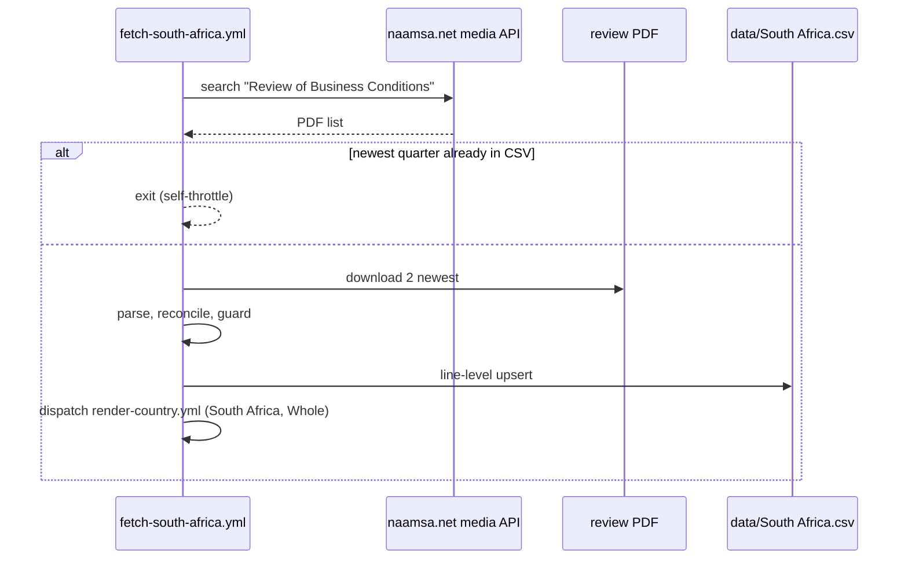

# 56 · Source: South Africa (naamsa Quarterly Review of Business Conditions)

**Status: LIVE from this PR.** Fetcher `scripts/fetch_south_africa.py`
(+ tests `scripts/test_fetch_south_africa.py`), workflow
`.github/workflows/fetch-south-africa.yml`. Replaces the 2026-07 probe
(`fetch_southafrica.py`, `fetch-southafrica.yml`). The gallery's first
African market.

> **Scope in one line:** the whole South African *new-vehicle* market
> (cars + bakkies/minibuses + trucks + buses), **not** new passenger cars (M1).

## TL;DR

```
naamsa.net (WordPress)
  └─ /wp-json/wp/v2/media?search=Review of Business Conditions   (JSON list)
       └─ YYYYMMDD-naamsa-<n>-Quarter-YYYY-Review-of-Business-Conditions.pdf
            ├─ §7  "aggregate industry new passenger car sales at N units …
            │       commercial vehicle sales … at M units"   (quarter + year ago)
            └─ NEV table: Traditional hybrid / Plug-in hybrid / Electric / Total NEVs
                          years 2019|2020 … last year, Q(year-1), Q(year)
                 │
                 ▼  fetch_south_africa.py   (pdftotext -layout)
  Electric→BEV · Plug-in hybrid→PHEV · Traditional hybrid→HEV
  TOTAL = passenger + commercial · ICE = TOTAL − NEVs · row on the middle month
                 │
                 └─ data/South Africa.csv   (line-level upsert, Whole, quarterly)
```

## 1. Why this source clears the bar (doc 14)

- **(a) the recognised body.** naamsa is the industry council that has
  published South Africa's official new-vehicle sales for decades; its data is
  compiled with Lightstone Auto and covers effectively the whole formal market
  including the Chinese entrants (BYD, Chery, GWM, Jetour, Omoda/Jaecoo report).
  There is no government registration statistic with a drivetrain split.
- **(b) complete enough.** The NEV table counts "30 industry brands" (2026).
  naamsa notes that new entrants started reporting in 2026, which lifted the
  NEV count — a real but small completeness drift, mentioned in the footnote.
- **(c) free and machine-readable.** Plain PDFs with a text layer, listed by a
  public JSON API; runners and the box reach naamsa.net without blocking
  (checked 2026-10-14). The Q4-2024 review is the one file whose first
  download looked image-only; a clean re-download parsed fine.

## 2. What exactly is counted — the segment definition

naamsa's domestic sales statistics have six segments (Flash Report December
2025, "New Vehicle Sales Totals"): **Passenger**, **Light CV < 3501 kg**
("light commercial vehicles, bakkies and minibuses"), **Medium CV
3501–8500 kg**, **Heavy CV 8501–16500 kg**, **Extra Heavy CV > 16500 kg**,
**Bus > 8500 kg**. Their sum is the "Industry Total" / "aggregate new vehicle
sales". Motorcycles are not part of naamsa's statistics.

The NEV table relates to that total, not to passenger cars:

- Q2-2026 review, p. 6: *"NEV sales comprised 5,6% of total new vehicle sales
  during the second quarter 2026"* — 8,611 / (109,236 + 43,883) = 5.62 %.
- Q2-2026 review, p. 6: *"For the full year 2025, NEV sales by 30 industry
  brands increased by 7,1% to 16,716 units … and comprised 2,8% of the total
  new vehicle market"* — 16,716 / 596,818 = 2.80 %.
- September 2026 media release, p. 2: *"Electrification is also beginning to
  extend beyond the passenger vehicle market, with emerging adoption across
  the light and medium commercial vehicle segments."*

**No segment-level drivetrain split exists in any naamsa publication checked**
(10 quarterly reviews 2024-Q1 … 2026-Q2, the monthly media releases and flash
reports). The flash reports list brands' total sales (top 15, local/export)
but no models and no drivetrain. Monthly passenger-car totals exist (e.g.
September 2026: 44,291), but without a drivetrain split, so an M1 series
would need an invented split — not done. No own classification is applied.

## 3. Row layout

`period` = middle month of the quarter (`Q1→-02 … Q4→-11`),
`time_interval = quarterly` (yearly rows: `YYYY-06`, `yearly`),
`variant = Whole`, `source = naamsa.net`, columns
`BEV, PHEV, HEV, ICE, TOTAL` (integers), `notes` names the scope.

## 4. History

| Rows | From |
|---|---|
| 2021-06, 2022-06 (yearly) | NEV years from the reviews' annual columns; TOTAL 2022 = 529,556 (Flash Report Summary Dec 2023, "Dec 2022 YTD"), TOTAL 2021 = 464,322 (sum of the four segment histories in Flash Report Standard Dec 2025). Written by `--backfill` only (`BOOTSTRAP_ROWS`). |
| 2023-02 … 2023-11 | year-ago columns of the 2024-Q1 … 2024-Q4 reviews |
| 2024-02 … 2026-05 | the reviews 2024-Q1 … 2026-Q2 (newest restatement wins) |

16 rows — below the 24 rows `R/build_backtest.R` needs, so South Africa is in
no Time-lapse month yet; it will enter by itself once the series is long enough.

## 5. Governance

| Check | What happens |
|---|---|
| Column sum | every NEV column must equal "Total NEVs" — else the review is skipped and listed |
| Year reconciliation | four quarters vs the annual column, ±max(5, 0.5 %); a PHEV↔HEV swap in one quarter that fixes it is applied and reported (Q4-2025 review: 2024-Q4 printed 4,156 / 261, 2025-Q4 3,452 / 1,026 in the wrong rows) |
| Completeness | newest total < 75 % of the year-ago quarter aborts (`--force` overrides), < 90 % warns |
| Foreign rows | a row with another `source` is never overwritten without `--force` |
| Restatements | rows from `naamsa.net` are overwritten by a newer review and listed as `updated` |
| Unknown layout | a review the parser cannot read is listed in the summary; the run fails only if none can be read |

Cross-check against naamsa's own sentences: 2026-Q2 NEV share 5.62 % (naamsa
"5,6 %"); 2025 NEVs 16,716 = 2.80 % of 596,818 (naamsa "2,8 %").

## 6. Operations and debugging runbook

| Symptom | Likely cause | Action |
|---|---|---|
| "naamsa media library lists no quarterly review" | WordPress search changed / blocked | open the media API URL above in a browser; adjust `list_reviews()` search terms |
| a review "not parsed (section-7 sales sentence not found)" | wording changed | add the new phrasing to `SALES_RE` and a test case |
| "NEV year header not found" | new header layout | extend the header search in `parse_review()`; add the layout to the tests (two layouts covered: `2020 …`, `FY2020 …`, `Year 2020 …`) |
| "quarters differ from the annual column … kept as published" | a restated year or a new print error | compare with the PDF; if it is a print error of a new kind, extend `reconcile()` |
| completeness guard fired | partial or wrong review | read the PDF; re-run with `force` only if the drop is real |
| rebuild offline | — | `python scripts/fetch_south_africa.py --backfill --dump-dir /tmp/za` once, then `--from-dir /tmp/za` |



## 7. What would make it better

- A segment-level (passenger-car) drivetrain table from naamsa or Lightstone
  — then a true `Whole` (M1) and a `Vans` variant.
- A monthly NEV split (the monthly releases carry year-to-date prose only).
