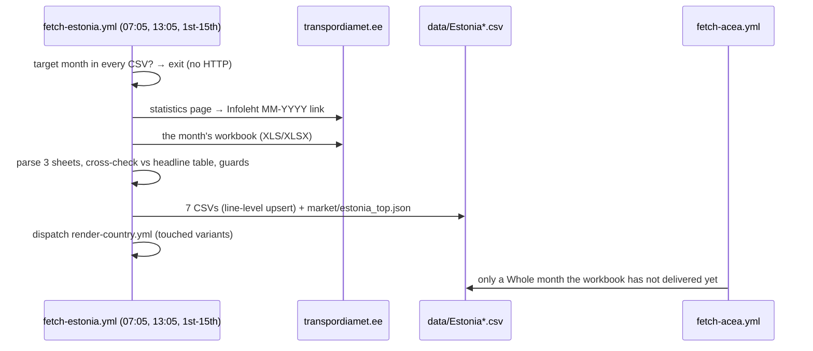

# 57 · Source: Estonia (Transpordiamet)

**Status: LIVE since 2026-10.** Fetcher `scripts/fetch_estonia.py` (+ tests
`scripts/test_fetch_estonia.py`), workflow `.github/workflows/fetch-estonia.yml`.
Transpordiamet writes all seven Estonia CSVs from 2021-01. ACEA (`fetch_acea.py`) moved
Estonia from its always-list to the conditional list and only fills a Whole month the
workbook has not delivered yet; `fetch_acea_cv.py` no longer writes Estonia.

## TL;DR

```
Source:    transpordiamet.ee/soidukitega-tehtud-toimingute-statistika
             Infoleht MM-YYYY (esmaste ja uute sõidukite statistika).xls[x]
               "Uued sõidukid"      every new vehicle: category, make, model, engine
                                    type, EU hybrid type, owner type, count
               "Kytus_esm (sh uued)" first registrations / of which new,
                                    by category × engine type (→ Used)
               "Esm(üldtabel)"      headline totals (cross-check)
Auth:      None.
Timing:    the month's workbook is up in the first days of the next month
           (September 2026 was posted in early October); ACEA publishes ~20th.
Variants:  Whole · Private · Industry · Used · Vans · HDV · Buses (all monthly).
Split:     counted per vehicle: OVC-HEV → PHEV, NOVC-HEV → HEV (§3).
           Used: one combined hybrid number in HEV, no PHEV column.
Check:     every month against the workbook's headline table — 69/69 pass,
           68 exact (§4.1). vs ACEA 2022-01..2026-08: +0.6% total,
           BEV/PHEV within a few cars a month (§4.2).
```

## 1. Why this source clears the bar

Estonia was an ACEA "always" country, and a poor one: quarterly figures until 2021, monthly
from 2022, three weeks after month end, with commercial vehicles only as reconstructed
quarters and BEV + PHEV merged. The country stub in `country_source_stubs.yaml` and the
2026-10 register round of [33](33-expansion-candidates.md) recorded the Transpordiamet
workbook as "the best lead left among the ACEA countries".

Transpordiamet keeps the register ACEA's Estonian figure is built from, so the new series
reproduces ACEA's (§4.2) — a new source extends the legacy series in the same categories.
It is free, needs no login, is machine-readable and is reachable from GitHub's runners and
from the dev sandbox. What it adds:

* a **counted** PHEV/HEV split per vehicle (the EU hybrid type), not a derived one;
* **monthly** history from 2021 (ACEA was quarterly until 2021);
* **Private / Industry** (owner type) and **Used** imports — 14,335 used against 14,823
  new cars in January–September 2026;
* **Vans, HDV and Buses** monthly with a full fuel split, instead of ACEA's quarterly
  reconstructions with BEV and PHEV merged;
* brand and model per vehicle (`market/estonia_top.json`).

## 2. Record → CSV row

### 2.1 Workbook layouts

One workbook per month, never restated. The sheets keep their names; the columns of
"Uued sõidukid" moved over the years, so `parse_new()` finds them by header name:

| Workbooks | Engine type | Hybrid type | Owner type | Count |
|---|---|---|---|---|
| 2021-01 … 2024-05, 2024-09 … 2025-11 (XLS) | `Mootori tüüp` | `Hübriidi tüüp` | `Tüüp` / `Tüüp (isik)` | `Arv` |
| 2024-06 … 2024-08 (XLSX) | `MOOTORI_TYYP` | `HYBRIIDI_TYYP` | `V.KAS/OM TYYP` | `tk` |
| 2025-12 … (XLSX) | `Mootori tüüp` | `Hübriidi tüüp` | `Tüüp (isik)` | `Arv` |

The owner type is always the column just before the count (the word "Tüüp" alone means the
vehicle type in newer files, the owner type in 2021). Engine types are spelled
`BENSIIN HÜBRIID` / `BENSIIN KAT` in 2021 and `BENSIIN_HYBRIID` /
`BENSIIN_KATALYSAATOR` later; owner types `FÜÜSILINE` and (2024-06 … 08) `FYYSILINE` —
`engine_code()` and `owner_code()` fold both. Workbooks before 2021 have no hybrid type
column (and earlier ones other layouts), which is why the source starts at 2021-01.

### 2.2 Variants

| Variant | File | From | Filter |
|---|---|---|---|
| `Whole` | `data/Estonia.csv` | "Uued sõidukid" | category M1, M1G |
| `Private` | `data/Estonia_Private.csv` | same | … owner type FÜÜSILINE |
| `Industry` | `data/Estonia_Industry.csv` | same | … any other owner type (JURIIDILINE, RIIGI, VÄLIS, ASUTAMISEL) |
| `Used` | `data/Estonia_Used.csv` | "Kytus_esm" | M1, M1G: first registrations − of which new, per engine type |
| `Vans` | `data/Estonia_Vans.csv` | "Uued sõidukid" | N1, N1G |
| `HDV` | `data/Estonia_HDV.csv` | same | N2, N2G, N3, N3G |
| `Buses` | `data/Estonia_Buses.csv` | same | M2, M2G, M3, M3G |

M1G (off-road M1) is part of ACEA's passenger-car figure, which is why the totals match.
Motorcycles, mopeds, trailers, tractors and machines (L, O, T, LM, MS categories) are in no
variant.

## 3. Powertrain mapping

`fuel_class(engine, hybrid)`, first match wins:

| Hybrid type / engine type | Column |
|---|---|
| hybrid type `OVC_FCHV`, `NOVC_FCHV`, or engine `VESINIK` | OTHERS (fuel cell) |
| hybrid type `OVC_HEV` | PHEV |
| hybrid type `NOVC_HEV` | HEV (full and mild) |
| engine `ELEKTER` | BEV |
| engine `*_HYBRIID`, no hybrid type | HEV — a few new cars a year (listed in the log); every used hybrid |
| engine `BENSIIN`, `BENSIIN_KATALYSAATOR` | PETROL — incl. petrol engines with an LPG / CNG kit |
| engine `DIISEL` | DIESEL |
| anything else (`CNG`, `GAAS`, …) | OTHERS |

Bi-fuel cars go by their engine type, not by the fuel combination column
(`Kütusekombinatsioon`, e.g. `BENSIIN-LPG`): ACEA's Estonian figure counts them as petrol
(its OTHERS is 0 from 2025), and the Used sheet has only the engine type, so one rule
serves every variant. Unknown engine, hybrid or owner values are listed as a warning and
stop the run above 2% of a month (`KNOWN_ENGINES`, `KNOWN_HYBRID`, `KNOWN_OWNER`).

## 4. Validation

### 4.1 Against the workbook's own totals (every run)

| Check | Result 2021-01 … 2026-09 |
|---|---|
| new M1+M1G ("Uued sõidukid") = headline "sh uued" passenger cars | 68 exact, 2024-07 one car short (1,882 vs 1,883) |
| new M1+M1G ("Kytus_esm") = headline "sh uued" passenger cars | 69 exact |
| first-registered M1+M1G ("Kytus_esm") = headline "Kokku" passenger cars | 69 exact |
| new N1–N3 = headline "sh uued" lorries; new M2+M3 = buses | 69 exact |

### 4.2 Against ACEA (the legacy series)

Whole, Transpordiamet minus the ACEA row it replaced (ACEA monthly from 2022):

| Year | Total | BEV | PHEV | HEV | Petrol | Diesel | Others |
|---|---|---|---|---|---|---|---|
| 2022 | +94 (+0.5%) | −20 | −27 | +109 | +48 | −19 | +4 |
| 2023 | +171 (+0.8%) | +2 | −4 | +70 | +69 | +33 | +1 |
| 2024 | +359 (+1.4%) | −2 | 0 | +180 | +89 | +87 | +5 |
| 2025 | +72 (+0.6%) | −21 | 0 | +18 | +48 | +2 | +25 |
| 2026 (Jan–Aug) | +82 (+0.6%) | +5 | 0 | +34 | +37 | +6 | 0 |

The largest month is 2024-12 (+151, 4%, the rush before the car tax of 2025); every other
month is within 2.5%. The −21 BEV / +25 OTHERS of 2025 is January 2025: 25 fuel-cell cars
that ACEA counted as BEV. For the 2021 quarters (ACEA quarterly) the gap is +3.1%, +1.0%,
+0.4% and +0.6%. Each replaced row keeps ACEA's figure in its `notes`
(`replaces ACEA (TOTAL 1479, +7; BEV 174 / …)`), the correction trail for later checks.

Vans, HDV and Buses against ACEA's quarterly reconstructions (`data/Estonia_legacy.csv`):
Vans within −1 … +3% (ACEA's "BEV" is BEV + PHEV and matches ours), HDV within a few
vehicles a quarter, Buses equal or within 1–5 vehicles (2026-Q2: 74 = 74, 18 BEV = 18).

## 5. Interplay with fetch-acea

| Row in `data/Estonia.csv` | Written by |
|---|---|
| ≤ 2020-12 | ACEA (quarterly, unchanged) |
| ≥ 2021-01, the workbook is out | Transpordiamet, ACEA's figure in the note when it replaced one |
| the workbook is late, ACEA has the month | ACEA (conditional), replaced by Transpordiamet on the next run |

Estonia is in `CONDITIONAL_COUNTRIES` in `scripts/fetch_acea.py`. `fetch_acea_cv.py` no
longer lists Estonia; its quarterly Vans/HDV/Buses rows (2021-07 … 2026-05) are parked in
`data/Estonia_legacy.csv` (an archive, not a series — `ARCHIVE_VARIANTS`).

## 6. Outputs

| File | What |
|---|---|
| `data/Estonia.csv` | Whole: ACEA to 2020-12, Transpordiamet from 2021-01 |
| `data/Estonia_Private.csv`, `data/Estonia_Industry.csv` | new M1 by owner type, from 2021-01 |
| `data/Estonia_Used.csv` | used imports from 2021-01 — no `PHEV` column, hybrids combined in `HEV` |
| `data/Estonia_Vans.csv`, `_HDV.csv`, `_Buses.csv` | from 2021-01, full fuel split |
| `data/Estonia_legacy.csv` | the former quarterly ACEA CV rows (archive) |
| `market/estonia_months.json` | per-month brand/model counts (store, generated) |
| `market/estonia_top.json` | Whole: top BEV/PHEV/HEV/petrol/diesel brands and models, last 12 months (`market_top.py`) |

No Used brand table: the Used variant is a difference of two sheets that carry no make
and model for used imports (only a top-10 of all first registrations).

## 7. Operations and debugging

* **Cron** `5 7,13 1-15 * *` (UTC). A run makes no HTTP request when the target month (last
  month) is a Transpordiamet row in every CSV. A run also picks up any month since 2021-01
  a CSV still lacks (up to six).
* **Dispatch inputs:** `variant`, `period` (YYYY-MM), `backfill` (every workbook from
  2021-01, ~90 MB), `force` (skip throttle, completeness, cross-check and foreign-row
  guards).
* **Offline:** `python scripts/fetch_estonia.py --from-dir DIR --backfill --dry-run` with
  the workbooks saved as `DIR/YYYY-MM.xls[x]` (`--dump-dir` saves them on a live run).
* The step summary lists the month's cross-checks and every written row with the change
  against the row it replaced.

### Debugging runbook

| Symptom | Likely cause | What to do |
|---|---|---|
| `No 'Infoleht' workbook links found` | the statistics page moved or the link text changed | open the page; compare the link text with `find_workbooks()` ("Infoleht MM-YYYY"); update the pattern and `test_find_workbooks` |
| `No workbook for YYYY-MM on the page yet` | not posted yet | nothing — the next run retries until the 15th; after that fetch-acea fills the month and the next month's run picks it up |
| `sheet 'uuedsõidukid' not found` / `no header row` / `missing engine/hybrid/make/model column` | a new workbook layout | open the workbook; extend `parse_new()` / `find_sheet()`; add the layout to `test_layouts` |
| `cross-check failed — new passenger cars …` | a sheet cut off or a new category code | compare the sheet with the headline table by hand; a new category goes into `CATEGORY_VARIANT` / `PASSENGER` / `LORRY` / `BUS` |
| `::warning New value … owner X` / `engine X` | a new owner or engine code | decide the mapping, add it to `KNOWN_OWNER` / `KNOWN_ENGINES` and a test case |
| `… N vehicles (x %) with unknown values` | many vehicles with a new code | as above — the run writes nothing until it is mapped |
| `TOTAL … is x % of the trailing median` | a partial workbook, or a real shock (the 2025 car tax halved January) | check the headline table; `force` if genuine |
| `kept (foreign source …)` | a row written by hand or another fetcher | inspect it; `force` only if Transpordiamet is right |

## 8. Sequence


