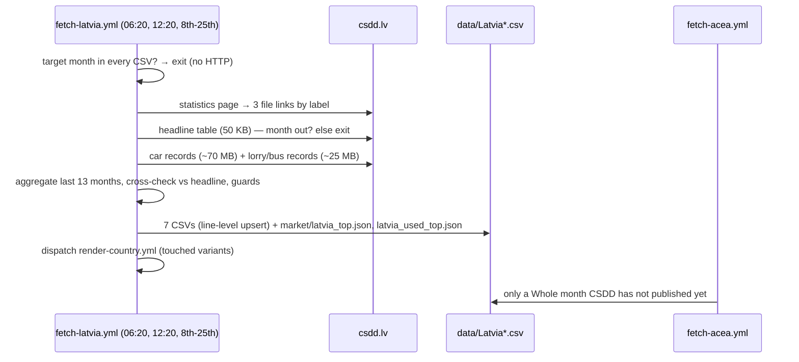

# 58 · Source: Latvia (CSDD)

**Status: LIVE since 2026-10.** Fetcher `scripts/fetch_latvia.py` (+ tests
`scripts/test_fetch_latvia.py`), workflow `.github/workflows/fetch-latvia.yml`.
CSDD writes all seven Latvia CSVs from 2015-01. ACEA (`fetch_acea.py`) moved Latvia from
its always-list to the conditional list and only fills a Whole month CSDD has not
published yet; `fetch_acea_cv.py` no longer writes Latvia.

## TL;DR

```
Source:    csdd.lv/transportlidzekli/transportlidzeklu-ikmenesa-dati
             Pirmoreiz reģistrēto TL skaits            headline table (cross-check)
             Pirmoreiz reģistrēto vieglo automobiļu skaits
                                    car records: make, model, fuel, new/used, keeper
             Pirmoreiz reģistrēto autobusu un kravas automobiļu skaits
                                    lorry/bus records: + EU category, energy source
Auth:      None.
Timing:    CSDD replaces the files ~10 working days after month end
           (September 2026 was up by 15 October); ACEA publishes ~20th–25th.
Variants:  Whole · Private · Industry · Used · Vans · HDV · Buses (all monthly).
Split:     BEV and PHEV counted (plug-in hybrids have their own fuel value);
           HEV not reported — full/mild hybrids are inside PETROL/DIESEL.
Check:     Whole = ACEA in all 120 months 2015-01..2024-12 (TOTAL, BEV, PHEV,
           petrol, diesel), 2025-01..2026-08 within 3 cars (§4).
```

## 1. Why this source clears the bar

Latvia was an ACEA "always" country. ACEA's figure arrives three weeks after month end,
has no owner or used-import split, and its commercial vehicles are reconstructed quarters.
Doc 33's 2026-09/10 register round looked at `data.gov.lv` only (stock snapshots); the
CSDD statistics page itself publishes the first-registration records, free, without
login, as XLSX, and was reachable from the dev sandbox. GitHub's hosted runners get no
answer from `www.csdd.lv` (connect timeout on two runners, 2026-10-16), so the workflow
goes through the project's Deno Deploy fetch relay — Cloudflare's egress gets no answer
either (522 through the Worker relay, same day) (§7).

CSDD keeps the register ACEA's Latvian figure is built from, and the record file
reproduces ACEA's monthly series to the car (§4). What it adds:

* the month **about ten days earlier** than ACEA;
* **Private / Industry** (keeper type) and **Used** imports — 32,766 used against
  17,536 new cars in January–September 2026;
* **Vans, HDV and Buses** monthly with BEV and PHEV separate, instead of ACEA's quarterly
  reconstructions with the two merged;
* brand and model for new **and** used cars (`market/latvia_top.json`,
  `market/latvia_used_top.json`).

What it cannot add: an HEV figure (§3).

## 2. Record → CSV row

### 2.1 Files

| File (link text) | Size | Sheet | Columns read |
|---|---|---|---|
| Pirmoreiz reģistrēto TL skaits | ~50 KB | one sheet for the current year, one for 2001–last year | per year a block "… YYYY. GADA MĒNEŠOS", month names, rows Kravas / Vieglie / Autobusi |
| Pirmoreiz reģistrēto vieglo automobiļu skaits | ~70 MB | `DATI` (~720,000 rows) | `GADS`, `MENESIS`, `MARKA`, `MODELIS`, `DEGVIELA`, `JAUNS`, `TURETAJS`, `KOPAA` |
| Pirmoreiz reģistrēto autobusu un kravas automobiļu skaits | ~25 MB | `DATI` (~165,000 rows) | `GADS`, `MENESIS`, `KATEGORIJA`, `ENERGIJAS_AVOTS`, `JAUNS`, `KOPAA` |

Columns are found by header name. In the headline table the month columns start in
column B (history sheet) or C (current-year sheet) — `parse_headline()` reads them from
the row of month names. Each file holds the full history and is replaced monthly; the
link URLs (`/cck?…&xi=N`) are positional, so `find_files()` matches the link text.

### 2.2 Variants

| Variant | File | Filter |
|---|---|---|
| `Whole` | `data/Latvia.csv` | car records, `JAUNS` = Jauns |
| `Private` | `data/Latvia_Private.csv` | … `TURETAJS` = FP |
| `Industry` | `data/Latvia_Industry.csv` | … `TURETAJS` = JP |
| `Used` | `data/Latvia_Used.csv` | car records, `JAUNS` = Lietots or "180 dienas" |
| `Vans` | `data/Latvia_Vans.csv` | lorry/bus records, new, N1, N1G |
| `HDV` | `data/Latvia_HDV.csv` | … N2, N2G, N3, N3G |
| `Buses` | `data/Latvia_Buses.csv` | … M2, M2G, M3, M3G |

"180 dienas" is a third status next to Jauns and Lietots: a few dozen cars a month,
mostly of the current model year. ACEA's new-car figure equals Jauns alone, so these cars
were first registered abroad before and are counted as Used. CSDD's page does not define
the status; the reading here is that they had a foreign registration of up to 180 days.

## 3. Powertrain mapping

| Fuel / energy source | Column |
|---|---|
| `Elektrība` | BEV |
| `Elektrība un benzīns`, `Elektrība un dīzeļdegviela` | PHEV |
| `Benzīns` | PETROL (incl. full and mild petrol hybrids) |
| `Dīzeļdegviela` | DIESEL (incl. mild diesel hybrids) |
| `Sašķidrinātā gāze (LPG)`, `Saspiestā gāze (CNG)`, `Ūdeņradis`, `Neuzdots` | OTHERS |

That "Elektrība un …" means plug-in hybrids only was checked by model: in 2026 its new cars
are Škoda Kodiaq (iV), VW Tayron / Tiguan (eHybrid), BYD Seal U DM-i, Audi Q5 TFSI e,
BMW X3 30e, Lexus RX450h+; its used imports BMW X5 xDrive45e, VW Passat GTE, Volvo T8,
Mitsubishi Outlander. Toyota's full hybrids (Yaris Cross, Corolla, C-HR, RAV4, Prius) are
`Benzīns`. So HEV is written empty — not published, not zero — and the chart draws its
curves without an HEV share, as for ACEA's Latvian rows before. An unknown fuel value is
counted as OTHERS and listed; above 2 % of a month the run stops.

## 4. Validation

### 4.1 Against the headline table (every run)

All passenger cars first registered in a month (every status), counted from the records,
against the headline "Vieglie":

| Months | Result |
|---|---|
| 2022-01 … 2026-09 (except 2023-12) | equal within 4 cars, most exactly |
| 2023-12 | records 4,123 vs headline 3,470 (new cars still equal ACEA) |
| 2015 … 2021 | records 0.4–1.6 % below the headline (the file is today's register) |

Only the last 13 months are enforced. Lorries (N1–N3) are mostly 0–16 % below the headline
"Kravas", which counts more lorry types; buses within a few vehicles in recent months —
both reported only.

### 4.2 Against ACEA (the legacy series)

Whole, CSDD minus the ACEA row it replaced:

| Year | Months identical | Total | BEV | PHEV | Petrol | Diesel | Others |
|---|---|---|---|---|---|---|---|
| 2015–2024 | 79 of 120 | 0 | 0 | 0 | 0 | 0 | +2 … +34 a year |
| 2025 | 7 of 12 | +8 | +5 | 0 | +1 | +2 | 0 |
| 2026 (Jan–Aug) | 3 of 8 | +5 | +4 | 0 | +1 | 0 | 0 |

Every month 2015–2024 has the same TOTAL, BEV, PHEV, petrol and diesel; in the months that
are not identical ACEA's OTHERS was a few cars lower with the same TOTAL. 2025–2026 differ
by at most 3 cars a month — late registrations CSDD booked after ACEA published. Each
replaced row's note says `= ACEA` or lists ACEA's differing values
(`replaces ACEA (TOTAL 1831, +3; ACEA had BEV 126 / TOTAL 1831)`).

Vans, HDV and Buses against ACEA's reconstructions (`data/Latvia_legacy.csv`): Vans equal in
2023-Q1/Q2, 0–13 % below ACEA in 2024–2026, with the same electric count (ACEA's "BEV" =
BEV + PHEV here); HDV equal in 2022–2023 where ACEA's quarters are sound, up to ~17 % below
in 2025–2026; Buses within 0–6 vehicles a quarter since 2023.

## 5. Interplay with fetch-acea

| Row in `data/Latvia.csv` | Written by |
|---|---|
| ≥ 2015-01, CSDD has the month | CSDD (`= ACEA` or ACEA's figure in the note when it replaced one) |
| CSDD has not published yet, ACEA has the month | ACEA (conditional), replaced by CSDD on the next run |

Latvia is in `CONDITIONAL_COUNTRIES` in `scripts/fetch_acea.py`. CSDD usually publishes
first, so this is rare. `fetch_acea_cv.py` no longer lists Latvia; its Vans/HDV/Buses rows
are parked in `data/Latvia_legacy.csv` (an archive, not a series — `ARCHIVE_VARIANTS`).

## 6. Outputs

| File | What |
|---|---|
| `data/Latvia.csv` | Whole, CSDD from 2015-01 |
| `data/Latvia_Private.csv`, `data/Latvia_Industry.csv` | new cars by keeper type |
| `data/Latvia_Used.csv` | used imports — replaces the legacy Used series rendered outside this repo |
| `data/Latvia_Vans.csv`, `_HDV.csv`, `_Buses.csv` | monthly, BEV and PHEV separate |
| `data/Latvia_legacy.csv` | the former ACEA CV rows (archive) |
| `market/latvia_months.json`, `latvia_used_months.json` | per-month brand/model counts (stores, generated) |
| `market/latvia_top.json`, `latvia_used_top.json` | top BEV/PHEV/petrol/diesel brands and models, last 12 months (`market_top.py`) |

All CSVs keep the `HEV` column, empty in every row.

## 7. Operations and debugging

* **Cron** `20 6,12 8-25 * *` (UTC). No HTTP when the target month (last month) is a CSDD
  row in every CSV; only the 50 KB headline file while CSDD has not published.
* A normal run rewrites the last 13 months (late bookings move a month by a car or two;
  only changed lines are written). `backfill` rewrites every month from 2015-01.
* **Dispatch inputs:** `variant`, `period` (YYYY-MM), `backfill`, `force` (skip throttle,
  completeness, cross-check and foreign-row guards).
* **Network:** every request goes through the Deno Deploy fetch relay
  (`worker/deno-relay.ts`, Google Cloud egress, `GET /fetch?url=`;
  [10](10-source-netherlands.md) §13) — `LATVIA_FETCH_RELAY` / `LATVIA_RELAY_TOKEN` in the
  workflow, filled from the Netherlands relay's secrets (`NL_FETCH_RELAY` /
  `NL_RELAY_TOKEN`, [07](07-secrets-trust.md)). `www.csdd.lv` is on the relay's host
  allow-list and its files are streamed through, not buffered. The Deno relay is
  deployed by hand (paste the file at dash.deno.com) — a change to it is live only after
  that. Neither GitHub's runners (connect timeout) nor Cloudflare's egress (`522` through
  the Worker relay) get an answer from CSDD. With `LATVIA_FETCH_RELAY` unset the fetcher connects
  directly, which works from a normal network.
* **Offline:** `python scripts/fetch_latvia.py --from-dir DIR --backfill --dry-run` with the
  files saved as `DIR/headline.xlsx`, `DIR/cars.xlsx`, `DIR/lorries.xlsx` (`--dump-dir`
  saves them on a live run). Parsing both record files takes ~45 s.

### Debugging runbook

| Symptom | Likely cause | What to do |
|---|---|---|
| `Statistics page: no link labelled …` | CSDD renamed a file or moved the page | open the page; update `FILE_LABELS` and `test_find_files` |
| `headline table has no YYYY-MM yet` | not published | nothing — retried until the 25th; fetch-acea fills the month after that |
| `no DATI sheet` / `DATI header lacks …` | a new file layout | open the file; adjust `iter_dati()` column names |
| `ConnectTimeout … www.csdd.lv` | a direct connection from a runner (CSDD does not answer GitHub's IP ranges) | check that `LATVIA_FETCH_RELAY` reaches the step (the secret is set) |
| `403 host not allowed: www.csdd.lv` from the relay | the deployed Deno relay predates the Latvia host | redeploy `worker/deno-relay.ts` at dash.deno.com ([10](10-source-netherlands.md) §13) |
| `403 host not allowed: …` (another host) | CSDD moved its files | add the host to `ALLOW_HOSTS` (and `STREAM_HOSTS`) in `worker/deno-relay.ts`, redeploy |
| relay `502` / `522` or a timeout through the relay | CSDD refuses that egress too (Cloudflare does: `522`) | a `*_PROXY`-style fallback or a data agreement with CSDD; ACEA keeps Latvia Whole meanwhile |
| `not an XLSX` | an HTML error page or a block | rerun; check the URL by hand |
| `cross-check failed — first-registered passenger cars` | a partial file, or a restatement | compare with the headline table by hand; `force` if the records are right |
| `::warning New value … fuel X` / `keeper X` / `status X` | a new register value | decide the mapping in `FUEL_CLASS` / `STATUS_*` / `KEEPER_*`, add a test |
| `TOTAL … is x % of the trailing median` | a partial file or a real shock | check the headline table; `force` if genuine |
| `kept (foreign source …)` | a row written by hand or another fetcher | inspect it; `force` only if CSDD is right |

## 8. Sequence


