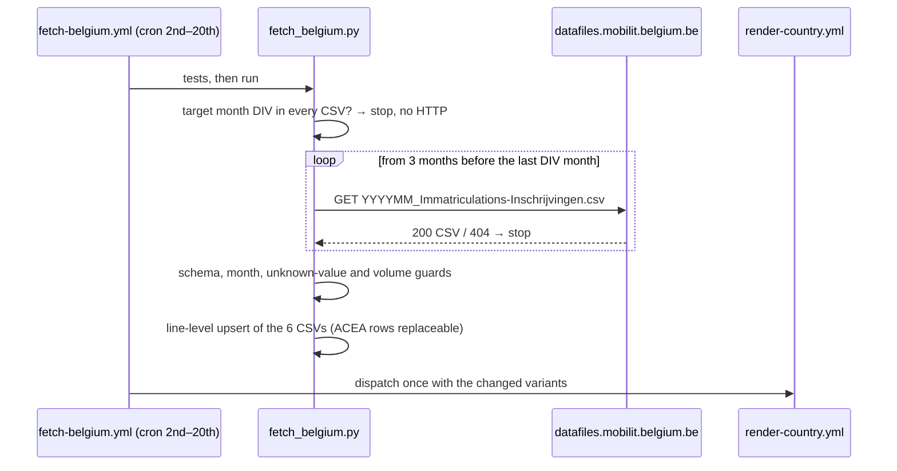

# 59 — Source: Belgium (FPS Mobility / DIV)

**TL;DR.** Belgium moved from ACEA to the FPS Mobility and Transport's own
monthly registration files (DIV, the vehicle registration service). They are
open data (CC0), ~220 KB a month, on a plain file server, published on the 2nd
of the following month — about three weeks before ACEA — and they are what
ACEA's Belgian figure is built from: Whole runs ~0.4 % above ACEA every month,
BEV agrees within ~30 cars. They add `Private` / `Industry` (VAT-registered
keeper) and turn Vans / HDV / Buses from quarterly ACEA reconstructions into
monthly series, all from 2013-01. Hybrids are split into plug-in (PHEV) and
non-plug-in (HEV, full + mild together).

## 1. Where the files are

The open-data page "Inschrijvingen van voertuigen" shows the monthly figures
as a Power BI report; its last page ("Downloaden") links the source files:

```
https://datafiles.mobilit.belgium.be/OPENDATA/DGTRSR/MonthlyRegistrations/
    YYYYMM_Immatriculations-Inschrijvingen.csv      202501 … (one per month)
    2013_2024_Immatriculations-Inschrijvingen.csv   history 2013-01 … 2024-12
```

* The web page (`mobilit.belgium.be`, also `statbel.fgov.be`) is behind an F5
  bot challenge with a CAPTCHA for scripts — from the sandbox and from GitHub
  runners alike. The **file server is not**: plain `200 text/csv`, no cookie,
  no challenge (checked 2026-10-15 from the sandbox).
* There is no directory listing (`/` and the folder answer 404), so the
  fetcher probes the name pattern forward; 404 = not published yet.
* Publication: each monthly file's `Last-Modified` is the 2nd of the following
  month at ~16:00 UTC (202606 → 2026-07-02, 202607 → 2026-08-02, 202608 →
  2026-09-02). Files are written once, not restated. **202609 was still 404 on
  2026-10-15** — DIV can be late, which is why the cron runs to the 20th and
  ACEA stays as a fallback.
* Licence: the FPS Mobility publishes its open data under CC0 (data.gov.be
  dataset 52ea177d…cdfe, "Inschrijvingen van voertuigen (maandelijks)").

## 2. Schema (14 columns, identical in every file)

| column | values |
|---|---|
| Month End Date | `2026-08-31 23:59:59` — the month |
| New Plate Flag Label | New Plate / Plate reused |
| New Vehicle Flag Label | New vehicle / Used vehicle |
| Titular Type Label | Legal Person (VAT) / Natural/Legal Person |
| Cylinder Capacity Range | `'-`, `0001-0799` … `3000+` |
| Vehicle Use Group Fr / Nl / De / En | Passenger car, Light goods vehicle, Lorry, Tractor unit for semitrailer, Bus, Trailer, Semi-trailer, Motor caravan, Agricultural vehicle, Light / Heavy two-, three- or four-wheel vehicle, Special purpose vehicle, `~?~`, Undetermined |
| Fuel Plus Fr / Nl / De / En | Electricity, Petrol, Gasoil, Hybrid Petrol, Hybrid Gasoil, Hybrid LPG, Plug-in Hybrid Petrol / Gasoil / LPG / CNG / Other, LPG, CNG, LNG, Hydrogen, Other, empty |
| N Rowcount | registrations |

The fetcher reads the English columns.

## 3. Mapping

See the processing block above (it renders as the decision tree on the source
page). Points worth knowing:

* **Plates follow the owner in Belgium.** A new car registered on a plate
  transferred from the keeper's previous car is "Plate reused" but still a new
  vehicle — both plate flags count (about 25–30 % of new cars). Counting only
  "New Plate" would undercount Whole by ~30 %.
* **Keeper type** is VAT-based: "Legal Person (VAT)" → Industry; "Natural/Legal
  Person" (no VAT number) → Private. In 2026 Industry is 54 % of new cars (61 %
  BEV), Private 46 % (11 % BEV).
* **Hybrids**: DIV distinguishes plug-in from non-plug-in, but not full from
  mild hybrids, so HEV = full + mild.

## 4. Validation

### 4.1 Against ACEA (Whole)

ACEA's monthly Belgian rows 2022-10 … 2026-08 (44 comparable months):

| | DIV − ACEA |
|---|---|
| TOTAL | +86 … +251 cars, median +155 (~0.4 %), never below — except 2025-04 (−5,075: DIV's file is short, below) |
| BEV | 0 … +34 cars |
| PHEV | median −1 %; 2025–2026 DIV 1–13 % lower |
| HEV | DIV ~2.5× higher (mild hybrids — ACEA files them under petrol/diesel) |

Two ACEA rows in the repo were wrong and are corrected by DIV: 2023-02
(2,291 — DIV 40,056) and 2023-09 (2,965 — DIV 39,034). 2026-07 is an ACEA
row derived from a year-to-date difference (ACEA had no July release); its
PHEV is 24 % above DIV.

**2025-04 is a short DIV file, not an ACEA error.** DIV has 32,737 cars,
ACEA 37,812 — and ACEA's figure is its own year-to-date difference
(Jan–Apr 158,751 − Jan–Mar 120,939). Over 2025 DIV is 3,386 below ACEA
(411,384 vs 414,770) although it is ~0.4 % *above* in every other month, and
the CV quarter holding April 2025 is 3–5 % low in Vans, HDV and Buses alike.
The DIV rows stay (their HEV includes mild hybrids like the rest of the
series; an ACEA row would put a one-month HEV dip into it), and their notes
say `CHECK`. Since 2026-10 the fetcher raises a `::warning::` and writes the
same remark when a month it writes over an ACEA row is more than 2 % off.

### 4.2 Against ACEA's CV quarters (Vans / HDV / Buses)

| quarter | Vans DIV / ACEA | HDV DIV / ACEA | Buses DIV / ACEA |
|---|---|---|---|
| 2024-Q1 | 18,264 / 18,211 | 2,798 / 2,779 | 265 / 265 |
| 2025-Q1 | 20,266 / 20,247 | 2,765 / 2,739 | 300 / 299 |
| 2025-Q2 | 18,506 / 19,146 | 2,187 / 2,284 | 519 / 544 |
| 2026-Q1 | 18,886 / 18,870 | 2,390 / 2,379 | 328 / 328 |
| 2026-Q2 | 18,605 / 18,585 | 2,292 / 2,279 | 291 / 290 |

DIV is ACEA's source for commercial vehicles too.

## 5. Variants and files

| file | variant | from |
|---|---|---|
| `data/Belgium.csv` | Whole | 2013-01 |
| `data/Belgium_Private.csv` | Private (new) | 2013-01 |
| `data/Belgium_Industry.csv` | Industry (new) | 2013-01 |
| `data/Belgium_Vans.csv` | Vans | 2013-01 |
| `data/Belgium_HDV.csv` | HDV | 2013-01 |
| `data/Belgium_Buses.csv` | Buses | 2013-01 |
| `data/Belgium_legacy.csv` | the former ACEA rows (Whole quarterly 2018–2022, all CV rows) — an archive, not a series | — |

January–August 2026: Whole 289,454 (BEV 37.7 %, PHEV 5.4 %, HEV 33.3 %),
Private 134,120, Industry 155,333, Vans 47,229 (BEV 7.4 %), HDV 5,791, Buses
864 (BEV 20.7 %).

## 6. Open decisions

* **Used.** DIV's "Used vehicle" (~55,000 passenger cars a month in 2026) mixes used imports
  with domestic changes of keeper, so it is left out. A `Resale`-style variant
  (all used-car registrations) would be possible if wanted.
* **HEV = full + mild.** Kept as DIV reports it (counted, not derived). The
  alternative — splitting HEV with ACEA's full-hybrid count — would mix a
  derived figure into a counted series.
* **params.csv** still holds the ACEA-era fits for Belgium Whole / Vans / HDV
  / Buses; the history now starts in 2013 and is monthly throughout, so a
  `backtest_only` refit is due.

## 7. ACEA's role

`fetch_acea.py`: Belgium moved from the always-list to the conditional list —
ACEA writes a Belgian month only when no DIV row exists yet, and the next DIV
run replaces it (`REPLACEABLE = {"ACEA"}`). `fetch_acea_cv.py`: Belgium left the
roster; its self-throttle sentinel is now Germany.

## 8. Runbook

| symptom | check |
|---|---|
| "not published yet (404)" for days after the 2nd | open the Power BI report's "Downloaden" page in a browser — did the file name pattern change? |
| "unexpected header" | DIV changed the schema: compare the new header with `HEADER` in the fetcher |
| "got an HTML page, not a CSV" | the file server now has the bot challenge too — run from a browser, report upstream |
| "unknown values" | a new fuel / use-group label: add it to `FUEL_CLASS` / `USE_VARIANT` / `USE_IGNORED` and a test |
| `::warning:: Belgium YYYY-MM vs ACEA` / notes say CHECK | DIV is more than 2 % off the ACEA row it replaced. Check ACEA's month against its year-to-date difference: if ACEA is consistent, DIV's file is short (as 2025-04) — the row stays, flagged; if ACEA is not, ACEA was wrong (as 2023-02 / 2023-09) |


