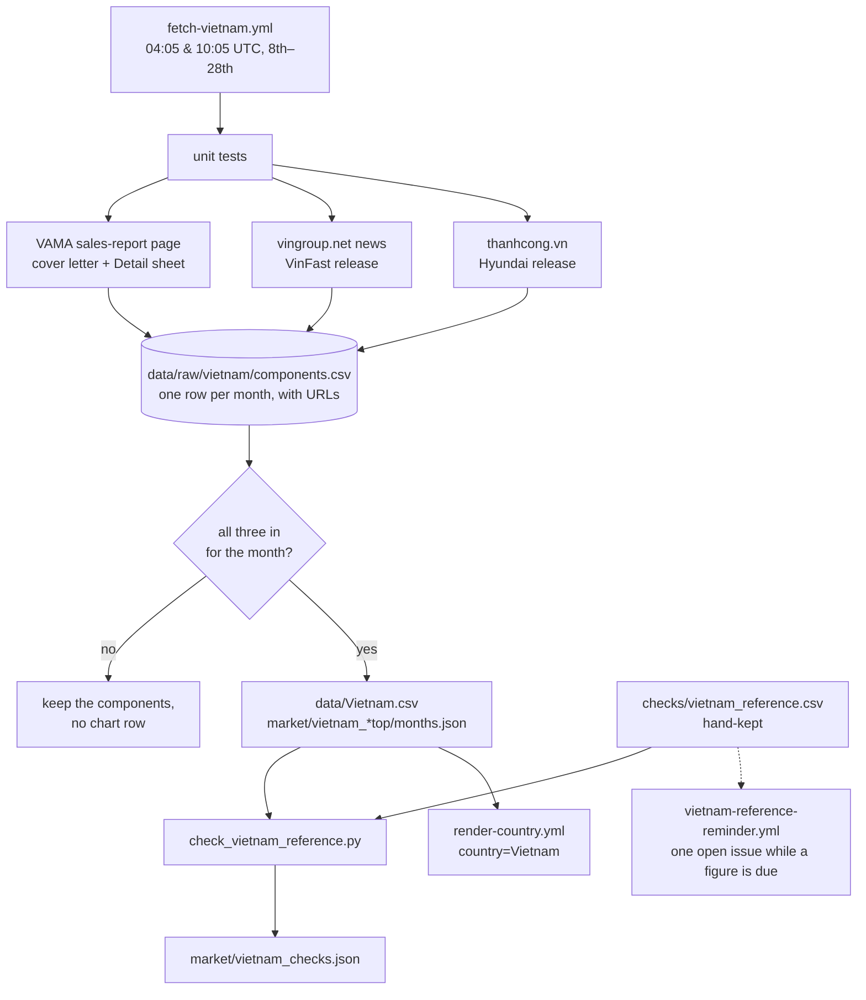

# 64 · Source: Vietnam (VAMA + VinFast + TC Group)

**Status: LIVE since 2026-10.** Fetcher `scripts/fetch_vietnam.py` (+ tests
`scripts/test_fetch_vietnam.py`, VAMA PDFs in `scripts/fixtures/vietnam/`), workflow
`.github/workflows/fetch-vietnam.yml`; inputs `data/raw/vietnam/components.csv`
([README](../../data/raw/vietnam/README.md)); reference figures
`checks/vietnam_reference.csv` → `scripts/check_vietnam_reference.py` →
`market/vietnam_checks.json`, reminder `.github/workflows/vietnam-reference-reminder.yml`.
Was on the candidate list ([33](33-expansion-candidates.md)) as shelved — no source
publishes Vietnam's market by fuel.

## TL;DR

```
Sources:   VAMA   vama.org.vn/en/sales-report.html — cover letter + Detail sheet (PDF)
           VinFast vingroup.net news (Vietnamese release; = the SEC 6-K figures)
           TC     thanhcong.vn/tin-tuc — Hyundai release with a model table
Auth:      none. sec.gov and vinfastauto.com refuse GitHub's runners (403); csgt.vn
           times out — hence vingroup.net and the hand-kept police figures.
Timing:    VinFast and TC ~10th, VAMA mid-month; polled 8th–28th twice daily.
Variant:   Whole — passenger cars ≈ M1, sales (charts say "new sales").
Columns:   BEV (VinFast + VAMA BEV) · HEV · MHEV (XL7/Ertiga Hybrid) · ICE (VAMA
           members' PC + Hyundai) · OTHERS (VAMA's non-member import estimate) ·
           TOTAL = VAMA PC + VinFast + Hyundai passenger. PHEV empty.
History:   2024-09 … (25 months at launch). September 2026: 51,013, BEV 46.3 %.
Check:     our all-vehicle sum = the media's national total in all 20 months with a
           figure (within rounding), except 2026-07 (VinFast revision).
```

## 1. Why three sources

Vietnam has no open registration data: the traffic police (CSGT) publish new
registrations only as half-year and year aggregates in press conferences, without a
fuel or brand split, and csgt.vn is not reachable from GitHub. What the Vietnamese
press calls "the market" each month is the sum of three company publications, and this
series is built the same way:

| Publisher | What it covers | Fuel detail |
|---|---|---|
| VAMA (association, ~20 members: Toyota, Ford, Honda, Mitsubishi, Suzuki, THACO's Kia/Mazda/Peugeot, Isuzu, Hino, …) | its members' sales by model, and one estimate of non-member imported (CBU) vehicles | BEV and Hybrid blocks; mild hybrids by model name |
| VinFast (not a member) | its domestic deliveries, every model electric | all BEV |
| TC Group / Hyundai Thành Công (not a member) | Hyundai sales by model, commercial row | none |

Brands outside all three — non-member brands assembling locally and personal imports —
are not covered; their imported cars are in VAMA's estimate.

## 2. From documents to columns

The composition (the `notes` front-matter item and `data/raw/vietnam/README.md` give
the formulas) was checked by hand for every month 2024-09 … 2026-09 against the
published national total (§3). Parsing:

- **Cover letter** (`pdftotext -layout`; pdfplumber breaks the bold totals
  apart): the period sentence, the total-industry sentence (PC / CV / SPV) and the
  "Subtotal" line of the members' Passenger cars, BEV and Hybrid sections (4th number =
  the month's total). All 25 months reproduce the hand-read figures.
- **Detail sheet** (pdfplumber words → cells by gaps; the header month is checked):
  maker, model, segment, month, year to date. THACO's makers map to Kia / Mazda /
  Peugeot, TCIEV to Nissan; CKD/CBU and model-year tags are dropped.
- **VinFast release**: month and units ("hơn" / "more than" = rounded), year to date,
  and the per-model figures of the month (sentences about year-to-date figures are
  ignored; a model list adding up to more than the month is dropped).
- **TC Group release**: the HTML table (this month = second-last column, previous
  month = third-last); "TỔNG" total and "XE THƯƠNG MẠI" commercial.

### Workflow



## 3. Reconciliation

Results 2024-09 … 2026-09 (all in `market/vietnam_checks.json`):

- **Media monthly totals** — 20 months with a published figure: 14 exact, 5 within the
  article's rounding or a media slip (2025-07: −11, the article used VinFast 11,490
  instead of 11,479), and 2026-07 −6.4 % because the media used VinFast's first figure
  (21,781) and we use the revised 17,996.
- **Media year totals** — 2025: 603,551 vs VnExpress 604,134 (−0.1 %).
- **CSGT registrations**, our months Dec → May / Dec → Nov against the police's
  15 Dec → 14 Jun / 14 Dec: H1 2025 +0.6 %, year 2025 −6.8 %, H1 2026 −3.2 %, 9M 2026
  +0.1 %. A different event (registration follows sale) and the police count includes
  trucks (122,235 in 2025), so this is shown for scale only.

## 4. Brand and model tables

`market/vietnam_top.json` ranks BEV / HEV / MHEV; `market/vietnam_all_top.json` ranks
every powertrain (class ALL — Hyundai and the non-member imports have no fuel split, so
an ICE table would be incomplete). Month store: 15 months each (`*_months.json`).
VinFast's unnamed models and Lexus/BMW-MINI (separate VAMA sheets, not parsed) are the
unranked remainder; "Other imports (all brands)" — VAMA's non-member estimate — is one pooled row, skipped as
the leading brand. A VinFast month revised downwards after its release has its models scaled to the
revised total.

## 5. Reference figures and the reminder

`checks/vietnam_reference.csv` (by hand): `kind,period_from,period_to,figure,rounded,url,note`
with kind `media_total` (a month), `media_year` (a calendar year) or `csgt` (police,
dates as published). `fetch-vietnam.yml` re-runs the comparison on every run and on
every push of the file. `vietnam-reference-reminder.yml` (02:45 UTC on the 12th–28th,
and the 1st–11th of January and July) lists what is due — the media total of each of
the three newest months from the 20th of the following month, CSGT H1 from 1 July, the
CSGT year from 5 January, rows without a URL — in its run summary and in ONE open issue
labelled `vietnam-reference` (found by the marker `<!-- vietnam-reference -->`), which
it closes once nothing is due. It is the first workflow here with `issues: write`.

## 6. Fragility and runbook

| Symptom | Cause | Fix |
|---|---|---|
| "cover letter … is for 2026-xx, not …" | VAMA posted the wrong file | dispatch with `vama_cover` = the right URL |
| warning: Detail Hybrid lines ≠ cover letter | VAMA's sheet and letter disagree (2025-04, 2025-06) | none — the letter is used |
| month stays incomplete after the 20th | a release not found (new URL pattern or wording) | dispatch with `vinfast_url` / `tc_url`; if a parser fails, fix it with a test |
| VinFast release never appears | vingroup.net changed its news pages | enter `vinfast`, `vinfast_ytd`, `vinfast_kind=manual` in the components file and dispatch with `rebuild` |
| notice "VinFast revision" | next month's YTD implies another figure | expected; the row is rewritten and noted |
| vama.org.vn unreachable | the site is http-only and slow | the run retries; dispatch later |

Reachability from GitHub's runners (2026-10 probe): vama.org.vn, thanhcong.vn,
vingroup.net and bocongan.gov.vn answer; sec.gov and vinfastauto.com return 403;
csgt.vn times out.
