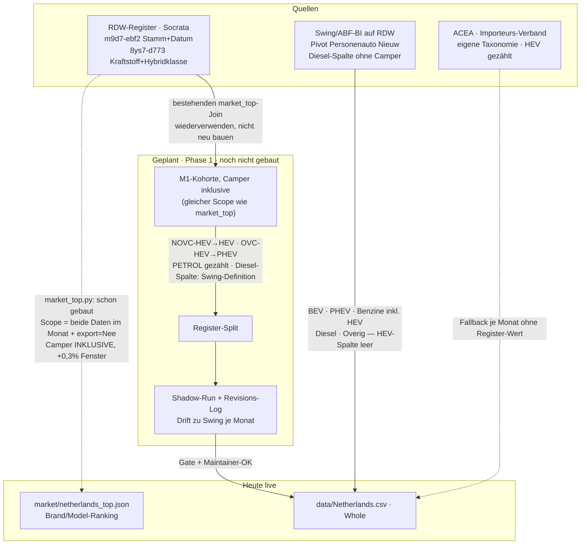
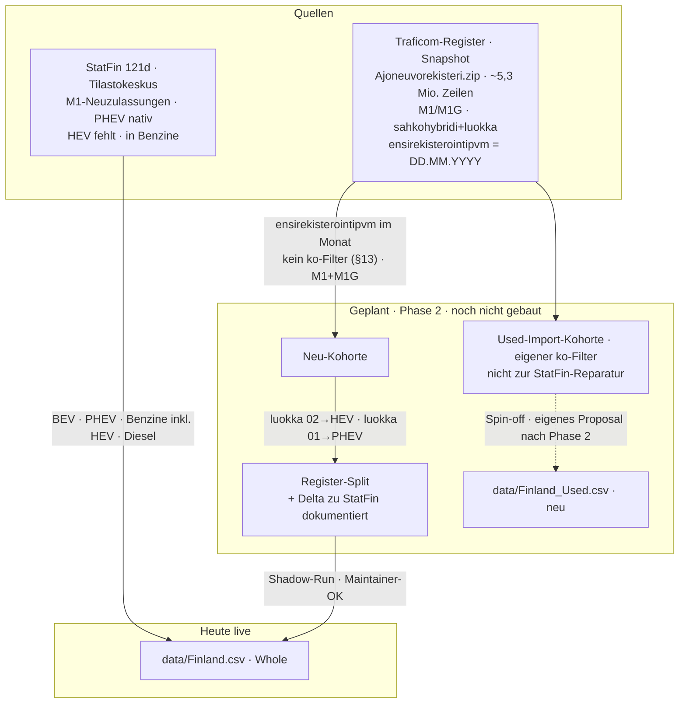

# 66 · Proposal: primary-register HEV split for Netherlands and Finland

**Status:** proposal, not started. Written 2026-11-19.
**Audience:** the maintainer + whoever implements this later.
**Relationship to the flyer stack (#450–#453, `feat/acea-hev-split`,
`feat/capture-benchmark`):** independent track. Nothing here blocks or is
blocked by the flyer PRs. The ACEA counted-split merge
(`scripts/acea_split.py`, Greece pattern) ships first for Denmark/Finland
as the flyer stack's fallback; this proposal replaces ACEA as the *primary*
source for Netherlands and Finland once built, leaving ACEA as the
cross-check/fallback exactly as Latvia already treats it
([58](58-source-latvia.md): "ACEA … the cross-check of the Whole series …
and the fallback for a month CSDD has not published yet").

## 0. Why this exists

The flyer briefs need a counted HEV row. Six gallery countries have no
native HEV column (`data/*.csv`, HEV blank on every monthly-Whole row):
China, Denmark, Finland, Hong Kong, Latvia, Netherlands. ACEA's release
carries a counted HEV figure for four of them (DK, FI, LV, NL) because
ACEA relays **national automobile manufacturers' associations**, not the
vehicle register — a different institution with a different fuel
taxonomy (confirmed: ACEA's own tables say `SOURCE: NATIONAL AUTOMOBILE
MANUFACTURERS' ASSOCIATIONS`, footnote "Includes full and mild hybrids").

That is why Denmark's statbank TOTAL and ACEA's Denmark TOTAL differ by
fractions of a percent despite being "the same country": statbank BIL53
and the Danish Motor Register (DMR) have **no non-plug-in hybrid value at
all** — every drivmiddel enumeration (Danmarks Statistik's own
documentation, and the weekly `ESStatistikListeModtag` extract) lists only
petrol/diesel/LPG/N-gas/electricity/kerosene/hydrogen/ethanol/**plugin
hybrid**/other. A full or mild hybrid is filed under its combustion fuel,
untagged. There is no primary-source HEV split to fetch for Denmark; ACEA
(or the importers' association ACEA relays) is the only source that has
one. **Denmark is out of scope for this proposal** — it stays on the ACEA
counted-split fallback permanently, not as a stopgap.

Latvia looks like a counter-example but isn't: CSDD's record files are
per-vehicle and daily-fresh, yet [58](58-source-latvia.md) documents
explicitly that the register's fuel field only distinguishes plug-in
hybrids (`Elektrība un benzīns` / `Elektrība un dīzeļdegviela`) — full and
mild hybrids are filed under Benzīns/Dīzeļdegviela with no tag, same gap
as Denmark. **Latvia is also out of scope**: more granular data does not
fix a taxonomy that doesn't exist upstream.

Spain is the pattern to copy, not a country to fix: DGT's microdata
already has `hev_split: true` with its own column
([28](28-source-spain.md)) — proof that a per-vehicle register *can* carry
a real hybrid class, when the registering authority records one.

Netherlands and Finland are the two countries where the register **does**
record the distinction, but the pipeline we currently use doesn't read
it:

| Country | Register field | Values | Current pipeline reads it? |
|---|---|---|---|
| Netherlands | `klasse_hybride_elektrisch_voertuig` (RDW open data, dataset `8ys7-d773` / view `vsxf-rq7p`) | `OVC-HEV` (plug-in), `NOVC-HEV` (full/mild, no plug), `OVC-FCHV`, `NOVC-FCHV` (fuel-cell variants) | No — Swing pivots ([10](10-source-netherlands.md)) only expose `Benzine`/`Diesel`/`Elektriciteit`, the hybrid class is not a Swing dimension |
| Finland | `sähköhybridi` (Y/N) + `sähköhybridin luokka` (Traficom open vehicle data) | `01` off-vehicle charging (plug-in), `02` engine-only charging (full/mild), `03`/`04` fuel-cell (not in use) | No — StatFin table 121d ([12](12-source-finland.md)) has no non-plug-in hybrid driving-power code at all |

Both are real primary sources, on the same underlying register the
current pipeline already trusts for TOTAL/BEV/PHEV — this is not a new
institution, it is a finer field on the register we already use.

## 1. Scope

**In scope:** Netherlands, Finland. One new fetch path per country that
reads the register's own hybrid-class field, produces a counted HEV
column, and reconciles against the existing TOTAL/BEV/PHEV series before
it is allowed to write.

**Out of scope, explicitly:**
- Denmark, Latvia — no upstream hybrid taxonomy exists (see §0). ACEA
  fallback is the permanent answer for Denmark; Latvia's HEV column stays
  blank as documented.
- China, Hong Kong — no ACEA coverage either; out of scope for both the
  flyer stack and this proposal (honest "Combustion + hybrids" label).
- The flyer rendering itself — that is the flyer stack's job. This
  proposal only changes what is in `data/Netherlands.csv` /
  `data/Finland.csv` (and their variant CSVs); the briefs pick up a real
  HEV row automatically once the column is populated, exactly as they
  already do for Greece.
- Daily cadence. Both registers publish on a monthly-ish lag (see §2);
  this is not a Spain-style daily-provisional pipeline. Do not promise
  daily freshness the source does not have.

## 2. Source facts (verified 2026-11-19, re-verify before building)

### Netherlands — RDW open data (Socrata)

- Dataset: `Open-Data-RDW-Gekentekende_voertuigen_brandstof` (`8ys7-d773`),
  view `Elektrische auto's` (`vsxf-rq7p`) exposes the 3-column subset
  (`kenteken`, `brandstof_omschrijving`, `klasse_hybride_elektrisch_voertuig`).
- Parent dataset `Gekentekende_voertuigen` (`m9d7-ebf2`): ~16.9M rows,
  98 columns, one row per licensed vehicle (not per registration event).
  `datum_eerste_tenaamstelling_in_nederland` is the first-Dutch-registration
  date — the field that defines "new this month", already the basis of the
  Swing pipeline's Whole variant.
- Access: Socrata SODA API (`https://opendata.rdw.nl/resource/8ys7-d773.json`),
  SoQL `$where`/`$select`/`$limit`/`$offset`, no auth for read. A month's
  new registrations can be filtered server-side by registration date —
  no need to download the full 16.9M-row table per fetch.
- **Open question (spike must answer):** does `8ys7-d773` carry the
  registration date itself, or must it be joined to `m9d7-ebf2` on
  `kenteken`? If a join is needed, the fetch is two queries per month
  (date-filtered parent → kenteken list → fuel/hybrid-class lookup), not
  one. Confirm row counts and join cost on one real month before designing
  the loop.
- **Snapshot semantics:** RDW open data is the register *as it is today*,
  not a frozen monthly snapshot — same property Latvia's CSDD files have
  ([58](58-source-latvia.md) §caveats: "more than a year back the record
  counts drift up to ~1.5% below the headline table written at the time").
  A vehicle deregistered/exported since its registration month disappears
  from a later fetch of that same month. This is the backward-overwrite
  risk §4 exists to control.

### Finland — Traficom open vehicle data (bulk CSV)

- Dataset: "Ajoneuvotiedot / Open data for vehicles",
  `avoindata.suomi.fi/data/en_GB/dataset/ajoneuvojen-avoin-data`,
  resource `00041d67-966e-48cf-a720-255faf09d55c`.
- ~5.25M rows, ZIP-packed CSV ~202 MB (930 MB unpacked), ISO-8859-1.
  **Whole-register snapshot**, vehicles currently in traffic use — not a
  monthly increment, not a query API. Every fetch downloads the full
  file and filters locally (same shape as Latvia's ~70 MB passenger-car
  record file, an order of magnitude larger).
- Publication cadence observed: material date 30.9.2025 published
  4.11.2025; material date 31.3.2025 published 6.5.2025 — roughly
  **quarterly-to-monthly with a ~5-week lag**, not daily, not reliably
  monthly. The fetch must treat "no new snapshot yet" as normal, not as
  an error, and must not block the StatFin pipeline (which stays primary
  for TOTAL/BEV/PHEV regardless).
- Fields: `sähköhybridi` (true/false), `sähköhybridin luokka`
  (01 = off-vehicle charging / plug-in, 02 = engine-only charging /
  full+mild hybrid, 03/04 fuel-cell, not in use). Classification sheet:
  `Ajoneuvotiedot_avoin_data_luokitukset_24.03.2026.xlsx` on
  `tieto.traficom.fi`. **Open question (spike must answer):** the exact
  column name for first registration date in this CSV, and whether
  "in traffic use" excludes vehicles deregistered since registration
  (same snapshot-drift risk as RDW/Latvia — assume yes until proven
  otherwise).
- No geo-block observed (unlike CSDD); verify from the CI runner's region
  before assuming the Latvia-style relay is unnecessary.

## 3. Architecture (mirrors 28/58, do not invent a new shape)

Per country, one new fetcher (`scripts/fetch_netherlands_register.py`,
`scripts/fetch_finland_register.py` — names TBD in the spike) that:

1. Reads the register's hybrid-class field for the target month's new
   registrations.
2. Aggregates to the canonical CSV columns, **only filling HEV** (and,
   if the reconciliation in §5 passes, optionally PETROL/DIESEL as a
   counted split instead of the current ratio-scale). TOTAL/BEV/PHEV
   stay owned by the existing pipeline (Swing for NL, StatFin for FI) —
   this proposal does not replace those, it adds the missing column.
3. Writes through the same `acea_split.merge`-style gate: the register's
   own TOTAL/BEV/PHEV for the month must agree with the existing CSV row
   within tolerance before the HEV count is trusted (same-month check,
   exactly the Greece/Denmark pattern already in `scripts/acea_split.py`).
4. Is documented in `10-source-netherlands.md` / `12-source-finland.md`
   with the same front-matter fields (`hev_split`, `hev_note`,
   `processing` decision tree, `caveats`) as Spain/Latvia — **written
   before the fetcher merges, not after** (see §6).

ACEA's counted split (`feat/acea-hev-split`) remains wired as the
fallback for any month the register fetch cannot fill (no snapshot yet,
reconciliation refused, fetch failed) — same precedence Latvia already
uses: register first, ACEA fills the gap, never the reverse.

## 4. Backward-overwrite policy (the part that must not be improvised)

Both sources are live snapshots, not frozen history. Re-fetching an old
month can return **fewer** vehicles than the row already committed
(deregistration/export since). This is the exact failure mode Latvia's
doc already names. Rules, non-negotiable:

- **A re-fetch may raise a month's count, never silently lower it.** If
  the new count for an already-committed month is lower than the stored
  value, the fetcher writes nothing for that month and logs a
  `revision-down` event (month, old value, new value, delta, source
  snapshot date) to a per-country revision log committed alongside the
  CSV (e.g. `data/Netherlands_revisions.csv`). A human decides whether
  the drop is a real deregistration correction or a fetch/scope bug.
- **Every write carries its provenance**: source snapshot date, fetch
  date, and whether the row is register-primary or ACEA-fallback, in the
  row's `notes`/`source` fields exactly as the existing pipelines do.
- **No bulk historical overwrite in one run.** Backfill is month-by-month
  with the same gate as a live fetch; a backfill that would change more
  than N months (N set in the spike, suggested 3) in one run stops and
  reports instead of writing.
- **The diff must be reproducible from the log alone**: given the
  revision log and the source snapshot dates, a reader must be able to
  reconstruct why any month's value changed, without re-running the
  fetch. This is the acceptance criterion for "delta nachvollziehbar".

## 5. Reconciliation gate (before any HEV value is trusted)

For each month the register fetch produces:

1. Compute register TOTAL/BEV/PHEV for the month from the same records.
2. Compare to the existing CSV row (Swing/StatFin). Gate: TOTAL within
   1%, BEV/PHEV within 2% (the Greece tolerance — these are the *same
   register*, so the gate should pass almost always; a failure means a
   scope/date-filter bug, not a real divergence, and must stop the write).
3. Only then write HEV (and optionally the counted petrol/diesel split).
4. Cross-check the resulting HEV against ACEA's figure for the same month
   where available. Log the delta; do not gate on it (ACEA is a different
   institution, §0, so a small delta is expected and informative, not a
   refusal) — but a delta above ~10% is a flag for manual review before
   the country switches primary.

**Switch-over criterion:** the register fetch must reconcile cleanly for
a consecutive run (suggested: 6 months, including at least one backfill
month and one live month) before ACEA is demoted from primary to fallback
for that country. Until then, both run and the register's output is
shadow-logged, not written.

## 6. Documentation requirement (explicit, per the maintainer)

Docs have been neglected on this stack; that does not continue here.
Before any fetcher code merges:

- `10-source-netherlands.md` and `12-source-finland.md` get the new
  `processing` decision tree, `hev_note`, `caveats` (snapshot drift,
  publication lag, reconciliation gate), and `source_links` to the exact
  dataset/resource IDs above — same depth as 28/58.
- This proposal's §2 "open questions" must be answered in the doc (not
  left as questions) once the spike resolves them.
- The revision-log format (§4) is documented in the country doc, not
  only in code comments.
- `build_source_pages.py --check` must pass with the updated front-matter
  before the PR is opened.

## 7. Phasing

- **Phase 0 — spike (throwaway, no production code).** One month per
  country, manual: confirm the join/date-field questions in §2, measure
  row counts and fetch cost, confirm the hybrid-class values map cleanly
  to HEV vs PHEV, confirm no geo-block for Traficom from CI. Output: a
  short findings note appended to this doc, and a go/no-go per country.
- **Phase 1 — Netherlands.** Smaller lift: the existing pipeline already
  reads RDW (via Swing); this adds a direct Socrata query for the hybrid
  class on the same register. Build fetcher + reconciliation + revision
  log + doc update. Shadow-run against ACEA for the switch-over window.
- **Phase 2 — Finland.** Larger lift: new bulk-download path (~202 MB),
  new source relationship (StatFin stays primary for TOTAL/BEV/PHEV,
  Traficom register added for HEV only). Same gates, same doc depth.
- **Phase 3 — demote ACEA to fallback** for each country once its
  switch-over criterion (§5) is met. Update `acea_split.MERGED_SOURCE` /
  the flyer stack's source attribution accordingly.

Each phase is its own PR against master, independent of the flyer stack.
No phase merges without the maintainer's explicit OK on the reconciled
output (same rule as the flyer stack: no merge without review).

## 8. Decisions (maintainer, 2026-11-19)

1. **Traficom lag: accepted.** Finland's HEV row may lag the rest of the
   brief by up to ~5 weeks; StatFin keeps delivering TOTAL/BEV/PHEV on its
   own cadence.
2. **Counted petrol/diesel: yes.** Once reconciliation passes, the
   register's counted petrol/diesel split replaces the ratio-scale — not
   HEV-only. Two more columns change, and the doc must say so.
3. **Thresholds (revision-log N, switch-over window): deferred** until
   the first real diffs are visible. The spike reports actual deltas
   before any threshold is fixed.

### Weitere Entscheidungen & Befunde (2026-11-20, Gespräch)

4. **M1 ist das Zielbild (Maintainer).** Für alle Länder ist die saubere
   EU-Kategorie M1 (inkl. M1G) das eigentliche Ziel, nicht die exakte
   Übereinstimmung mit der nationalen Statistikstelle. Ein Delta zu
   StatFin/Swing ist akzeptabel, wenn es **bekannt und dokumentiert** ist.
   Register-primary wird daran ausgerichtet; das Delta kommt in die
   Source-Doc (und, wo es die Kurve ändert, in die Footnote).
5. **NL `export_indicator` ist Gegenwarts-Zustand, kein Monatsfilter
   (Befund, im Repo festzuhalten).** Siehe §10. Nicht als Filter für den
   Zulassungsmonat verwenden — Snapshot-Drift nach oben akzeptieren und
   über das Revisions-Log (§4) führen.
6. **FI Used-Import-Variante als Spin-off (Maintainer-Idee).** Das
   `kayttoonottopvm`-Datum trennt Used Imports im selben Snapshot; eine
   eigene `Finland_Used`-Variante ist ohne neue Quelle machbar. Eigenes
   Proposal/PR nach Phase 2 (Drift-Policy beachten: ältere Autos driften
   stärker).

Primary-source work happens in a separate session; the flyer stack is the
current focus. This branch stays plan-only until that session picks it up.

## 9. Phase 0 spike findings (2026-11-20, throwaway scripts in
`~/.hermes/cache/scratch/hev66/`, no production code written)

### Netherlands

- **No cross-dataset SoQL subquery.** `kenteken in (select ... from m9d7-ebf2 ...)`
  400s ("Expected an expression, but got `SELECT`"). The two-query join
  from §2 is mandatory: pull `kenteken` from the parent with a date filter,
  then fetch `8ys7-d773` fuel rows in chunks (`kenteken in ('a','b',...)`).
  GET works at 400 kentekens/chunk; a 2000-chunk POST got `403
  authentication_required` from an anonymous session — stick to GET/400.
  ~25k kentekens joins in well under a minute.
- **The cohort filter is `datum_eerste_tenaamstelling_in_nederland_dt` AND
  `datum_eerste_toelating_dt` both in the target month**, not either alone
  (tested 5 variants against Swing's April figure; this combination came
  closest). Even then the register ran **+1.4% TOTAL** above Swing's April
  row after removing campers (see below) — a `TOTAL_TOLERANCE=1%` gate
  (Greece's own threshold) would be a near-miss most months, not a clean
  pass. BEV +1.8%, PHEV +2.3% individually exceed the Greece plugin
  tolerance (2% of national value, min 5 cars) on this one month. Needs
  either a slightly looser NL-specific tolerance or acceptance that most
  months get logged as a gate-refusal and fall back to ACEA until the
  filter is tuned further (try: excluding `export_indicator=Ja`, or a
  narrower toelating window).
- **Root cause of the big Diesel gap (458 vs Swing's 16, a 28x miss):**
  campers (`inrichting=kampeerwagen`, 415 of 458) are Personenauto-classed
  M1 vehicles in RDW but Swing's "Instroom Personenauto Nieuw" pivot
  evidently excludes them. Filtering `inrichting != 'kampeerwagen'` drops
  Diesel to 55 (Swing: 16) — still 39 over, smaller gap, not closed.
  **A camper exclusion needs to be in the production fetcher**, not a
  one-off note.
- **Hybrid class values confirmed exactly as documented:** `OVC-HEV` →
  PHEV, `NOVC-HEV` → HEV, cleanly separable, no third bucket seen in the
  April sample (36,340 vehicles joined with 0 vehicles missing a fuel row).
- **Open question not yet resolved:** whether the +1.4% residual (after
  camper exclusion) is itself export-related, LPG double-counting, or a
  Swing-side undercount — needs one more month's reconciliation attempt
  with export_indicator and LPG-overlap filters before Phase 1 can set a
  real tolerance.

### Finland

- **Traficom snapshot confirmed current**: `Ajoneuvorekisteri.zip`,
  206 MB compressed / 956 MB raw, `Last-Modified: 2026-10-14`, material
  date inside the file is 2026-09-30 (`ensirekisterointipvm` date format
  is **`DD.MM.YYYY`, not ISO as the classification sheet's own docs claim**
  — verify this before writing a parser, it silently groups rows into the
  wrong month otherwise). 5,260,993 rows, loads and streams in ~15s on a
  Mac.
- **`kayttoonottopvm` (introduction-to-use date) is the key discovery.**
  A large share of M1 rows with `ensirekisterointipvm` in a given month
  have a `kayttoonottopvm` from a prior year — these are **used imports**
  re-registering in Finland (sample: a 2020 Tesla Model 3, a 2022 Audi
  Q4 e-tron, both first-introduced years before their Finnish
  registration month). Filtering to `kayttoonottopvm` in the same
  calendar month as `ensirekisterointipvm` is the "genuinely new"
  cohort — same concept as the NL join needing both dates in-month.
- **StatFin 121d (the current TOTAL/BEV/PHEV source) likely already
  excludes these used imports** — the raw `ensirekisterointipvm`-only
  cohort for 2026-06 M1 was 10,017 vs. StatFin's CSV row of 7,566 TOTAL
  (+32%); the `kayttoonottopvm`-in-month filter narrows this to 7,091
  (+6.2%, much closer but not exact — a residual gap remains, possibly a
  private/industry possessor split or a day-boundary issue worth another
  pass before Phase 2 commits to the filter).
- **PHEV is undercounted by driving-power code 39/44 alone** (the doc's
  §2 API query) in newer data: the `sahkohybridi`/`sahkohybridin luokka`
  fields (Y/N + 01 plug-in / 02 full-mild) are the authoritative split,
  confirmed against the classification workbook
  (`Ajoneuvotiedot_avoin_data_luokitukset_24.03.2026.xlsx`, sheets
  `KAYTTOVOIMA`, `sähköhybridi`, `sähköhybridin luokka`) — `02`
  (engine-only charging) = HEV, `01` (off-vehicle charging) = PHEV, `03`/
  `04` fuel-cell not yet in use, exactly as §2 says.
- **Usage-code split available for free**: `ajoneuvonkaytto` carries the
  same private/rental/taxi/school codes as the doc's §89 "Private" variant
  needs, so a Traficom-primary Private variant is feasible without a
  second data source.

### Go/no-go per country (Phase 0 verdict)

- **Netherlands: go, with one more reconciliation round.** The join
  works, the hybrid-class field is exactly as documented, and the
  remaining gap (camper exclusion + ~1.4% residual) is tunable, not a
  blocker. Needs a camper-exclusion rule and one more month's filter
  tuning before Phase 1 can set real gate tolerances.
- **Finland: go, with the `kayttoonottopvm`-in-month filter as the
  working scope hypothesis**, but the residual +6.2% gap to StatFin on
  2026-06 is not yet explained — one more reconciliation pass (try
  possessor/usage-code filtering, or compare a month StatFin has already
  revised) is needed before Phase 1 commits to this filter as final.
- Both still clear the core premise of this proposal: the register DOES
  carry a clean, separable HEV field distinct from PHEV, with no
  unclassified residual bucket in the samples checked.

Primary-source implementation (Phase 1 Netherlands, Phase 2 Finland) can
start from here; both still need the backward-overwrite / revision-log
infrastructure in §4 before any fetcher writes to `data/`.

## 10. Spike round 2 (2026-11-20): Delta zerlegt

### Netherlands — KORREKTUR: Camper sind im Total, der Scope steht schon

> **Korrektur (round 2 war falsch).** Die erste Fassung dieses Abschnitts
> behauptete, Swing schließe Wohnmobile aus und `export_indicator` dürfe
> nicht filtern. Das war ein Fehler aus einer **veralteten lokalen
> Doc-Kopie**: `10-source-netherlands.md` §11 auf `origin/master` und
> `scripts/market_top.py` haben den RDW-Scope längst gebaut und über
> 12 Monate (2025-07 → 2026-06) gegen die CSV validiert. Die unten stehende
> Schritt-Tabelle ist der Irrweg der Untersuchung, nicht das Ergebnis.

**Der etablierte, getestete Scope** (`market_top.py`, doc 10 §11):
`voertuigsoort = Personenauto` + **beide** Daten im Monat
(`datum_eerste_tenaamstelling_in_nederland_dt` und `datum_eerste_toelating_dt`)
+ **`export_indicator = Nee`**, **Wohnmobile INKLUSIVE**. Damit April 2026:

| | Register (korrekter Scope) | Swing | Δ |
|---|---|---|---|
| TOTAL | 24.985 | 24.739 | +0,99 % |
| BEV | 9.415 | 9.457 | −0,44 % |
| PHEV | 5.822 | 5.774 | +0,83 % |
| OTHERS | 111 | 111 | 0 |

Das Fenster über 12 Monate: **+0,3 %** (BEV +0,1 %, PHEV +2,2 %), jeden Monat
−0,8 % … +1,9 % — die live-Register-vs-Snapshot-Drift, dokumentiert.
`market_top.check_scope` loggt jeden Monat und stoppt bei >10 % Drift.

- **Wohnmobile SIND im Whole-Total** (doc 10 §11 wörtlich: "are in the total
  like in Swing"). ~400/Monat, fast alle Diesel, erreichen nie die BEV/PHEV-
  Liste. Der einzige Ort, wo sie sichtbar auseinanderlaufen, ist die
  **Diesel-SPALTE**: Swing's Diesel ≈ 16 zählt die Wohnmobile nicht, das
  Register-Diesel ≈ 457 ist überwiegend Wohnmobile. Die Brand-Table rankt
  Diesel deshalb schon nicht mehr.
- **`export_indicator = Nee` IST der richtige Filter** (entgegen round 2).
  Er entfernt aktuell exportierte Platten und trifft damit Swings
  Snapshot-Scope empirisch besser als ohne. Mein Einmonats-Test hatte
  *zusätzlich* fälschlich Camper ausgeschlossen und dadurch unter das Ziel
  geschossen — der Fehler war die Camper-Exclusion, nicht der Export-Filter.

**Enrichment-Folge (nachgerechnet):** Swing-Basis (TOTAL/BEV/PHEV) +
Register-HEV/PETROL geht sauber auf. **Diesel nicht:** Register-Diesel mit
Campern (457) in die Swing-Zeile → OTHERS-Residual **−129 (negativ, kaputt)**;
ohne Camper (55) → Residual 273 (über Register-OTHERS 111). Swing's
Diesel-Bucket ist enger als "Register-Diesel minus Camper". HEV (`NOVC-HEV`,
April 7.263) ist davon unberührt und sauber zählbar.

**Konsequenz für Phase 1:** den bestehenden `market_top.py`-RDW-Pfad
**wiederverwenden** (Join, `FUEL_BATCH`, Month-Store, `check_scope` existieren
schon), nicht einen Parallel-Fetcher erfinden. HEV (+ PETROL) aus dem
Register anreichern; TOTAL/BEV/PHEV bleiben Swing; DIESEL entweder Swing
lassen oder die Camper-Exclusion **nur auf die Diesel-Spalte** anwenden, um
Swings enge Definition zu treffen — dokumentiert. Die ~1 % Total-Drift
bleibt Swing-eigen.

### Finland — M1G fehlte, und das Delta wohnt im ko-4–12-Monate-Bucket

`M1` allein lässt **M1G** (Gelände-PKW, die SUV-Kategorie) weg — und M1G
ist fast nur PHEV. Mit M1+M1G und ko-Distanz-Buckets (M1+M1G, neu =
`kayttoonottopvm` im Zulassungsmonat):

| Monat | neu (ko im Monat) | ko 1–3 Mo. vorher | ko 4–12 Mo. vorher | ko >12 Mo. (Used) | StatFin |
|---|---|---|---|---|---|
| 2025-06 | 7.125 | 71 | 261 | 2.806 | 7.452 |
| 2026-06 | 7.276 | 74 | 245 | 2.788 | 7.566 |
| 2026-09 | 6.809 | 66 | 244 | 3.005 | 6.985 |

- **ko 4–12 Monate vorher (~250/Monat, fast nur BEV+PHEV)** sind
  Neuwagen-Importe (junge Gebrauchte / Tageszulassungen aus DE). Nimmt man
  sie zur Neu-Kohorte dazu: **2025-06: 7.457 (+5, +0,07 %), 2026-06: 7.595
  (+29, +0,4 %)** an StatFin. Der frischeste Monat 2026-09 bleibt +1,9 %
  darüber — konsistent mit StatFin-Revisions-Lag (jüngste Monate werden
  nachträglich hochrevidiert).
- **Das Delta ist also bekannt und lokalisiert**, nicht mehr rätselhaft:
  es ist die Neu/Used-Grenze. StatFin zieht sie offenbar bei ~12 Monaten
  Fahrzeugalter, nicht bei "ko im selben Monat". Die exakte Grenze aus
  Tilastokeskus-Metadaten bestätigen, bevor Phase 2 sie festschreibt.
- **Used-Import-Kohorte (ko >12 Mo.): ~2.800–3.000/Monat**, eigene
  Fuel-Split verfügbar → Spin-off-Variante `Finland_Used` (§8.6).
- Datum-Falle bestätigt: `ensirekisterointipvm` = **DD.MM.YYYY** (nicht ISO
  wie das Klassifikationsblatt behauptet); `kayttoonottopvm` = VVVVKKPP.

## 11. Herkunft / Fluss (visuell)

Repo-Konvention sind Mermaid-Flowcharts mit Subgraphs (siehe
`05-flows.md`, `02-components.md`) — sie rendern direkt auf GitHub. Echtes
BPMN-XML bräuchte einen Viewer und ist hier nicht etabliert; die
Swimlane-Form unten erfüllt denselben Zweck ("woher kommt was"). Wenn die
Fetcher gebaut sind, ziehen diese Diagramme nach `05-flows.md` bzw. in die
Source-Docs (§6-Doku-Pflicht).

### Netherlands

### Finland

## 12. Weiteres Vorgehen

### Netherlands (Phase 1)

1. **Kein neuer Fetcher.** Den bestehenden `scripts/market_top.py`-RDW-Pfad
   (Join, `FUEL_BATCH=800`, Month-Store `market/netherlands_months.json`,
   `check_scope`) um HEV + gezähltes PETROL erweitern — Scope bleibt
   `voertuigsoort=Personenauto` + beide Daten im Monat + `export_indicator=
   Nee`, **Camper inklusive** (wie bisher). Nur die Diesel-Spalte braucht
   eine explizite Entscheidung: Swing-Diesel (≈16) übernehmen oder
   Register-Diesel minus Camper (≈55, noch 39 über Swing) — nicht einfach
   Register-Diesel roh (457, sonst negatives OTHERS-Residual).
2. **Revisions-Log (§4)** gegen den Snapshot-Drift (Nachzügler nach oben,
   das bestätigte +0,3%-Fenster); ein Re-Fetch darf einen committed Monat
   nie still senken.
3. **Shadow-Run neben Swing** (schreibt noch nichts nach `data/`), Deltas
   je Monat loggen → daraus die echte Toleranz und das Switch-over-Fenster
   (§5, §8.3 — deferred bis echte Deltas sichtbar).
4. **Nach Maintainer-OK + Switch-over:** Register-primary für HEV +
   gezählten Split; TOTAL/BEV/PHEV bleiben bis dahin Swing. Ändert sich
   eine veröffentlichte Zahl → `Release:`-Zeile + Render-Gate.
5. Doku (§6): `10-source-netherlands.md` bekommt `hev_split`, die
   Diesel-Spalten-Entscheidung, das Herkunfts-Diagramm — **vor** dem
   Merge. Scope-Text selbst bleibt wie er ist (schon korrekt).

### Finland (Phase 2)

1. **Fetcher `fetch_finland_register.py`**: Traficom-Snapshot, **M1+M1G**,
   Neu-Kohorte = `ensirekisterointipvm` im Zulassungsmonat (**kein**
   `kayttoonottopvm`-Filter, siehe §13-Korrektur); HEV aus `luokka 02`,
   PHEV aus `luokka 01`; Datum DD.MM.YYYY parsen.
2. **Delta zu StatFin ist Snapshot-Drift, dokumentieren statt jagen**
   (§13): je älter der Monat, desto größer das Minus. Toleranz/Revisions-
   Log (§4) daraus ableiten, keine weitere Scope-Suche.
3. **StatFin bleibt primary für TOTAL/BEV/PHEV** (Proposal §3); Register
   liefert HEV + die saubere M1-Kategorie. Das Delta zu StatFin kommt in
   `12-source-finland.md` (und in die Footnote, wo es die Kurve ändert).
4. **Spin-off `Finland_Used`** (§8.6, §13): eigener Filter
   `kayttoonottopvm` deutlich vor `ensirekisterointipvm`, als Differenzier-
   ungsmerkmal, nicht als StatFin-Reparatur; eigenes Proposal/PR nach
   Phase 2 mit eigener Drift-Policy.
5. Doku (§6): `12-source-finland.md` mit `hev_split`, Datums-Falle,
   Delta-Tabelle, Herkunfts-Diagramm — vor dem Fetcher-Merge.

## 13. Spike round 3 (2026-11-20): NL über mehr Monate, FI-Korrektur

### Netherlands — bestätigt über 4 Monate, Camper-Diesel-Muster stabil

Zusätzlich 2026-09 und 2026-10 im korrekten Scope (beide Daten im Monat +
`export_indicator=Nee`, Camper inklusive) gegen Swing geprüft:

| Monat | TOTAL Δ | BEV Δ | PHEV Δ | Register Diesel (davon Camper) | Swing Diesel |
|---|---|---|---|---|---|
| 2026-04 | +0,99 % | −0,44 % | +0,83 % | 457 (402) | 16 |
| 2026-09 | −0,55 % | +0,50 % | +0,12 % | 156 (116) | 10 |
| 2026-10 | +0,16 % | +0,77 % | +2,80 % | 153 (103) | 10 |

Alle vier Monate liegen im von doc 10 §11 dokumentierten Band (−0,8 % …
+1,9 %, Fenster +0,3 %). Das Camper-Muster ist **stabil, kein Einzelfall**:
~70 % des Register-Diesels sind durchgängig Wohnmobile. **Diesel-Spalten-
Entscheidung (aus §10, jetzt mit 4 Monaten Beleg):** Swing-Diesel so
übernehmen, HEV/PETROL aus dem Register anreichern — die Camper-Frage
betrifft nur die eine Spalte, nicht das Total, und ist damit kein Blocker
mehr für Phase 1.

### Finland — KORREKTUR: StatFin zählt Used Imports selbst, die ko-Grenze war falsch herum

> **Korrektur (round 2 lag falsch).** Tilastokeskus' eigene Methodendoku
> (stat.fi/fi/tilasto/dokumentaatio/merek/…, abgerufen 2026-11-20) sagt klar:
> die Grundgesamtheit der 121d-Statistik ist *"Manner-Suomen liikenneasioiden
> rekisteriin merkityt ensirekisteröidyt **uudet sekä käytettynä maahantuodut**
> ajoneuvot"* — StatFin zählt Neuwagen **und** Gebrauchtimporte zusammen,
> sofern es die erste Zulassung **in Finnland** ist. Mein ko-Monat-Filter
> (round 2) hat Gebrauchtimporte aus der Neu-Kohorte rausgefiltert, weil ich
> annahm, StatFin würde sie nicht zählen — das war falsch herum.
>
> Zusätzlich trennt Tilastokeskus zwei ähnlich benannte, aber verschiedene
> Begriffe: **„Ensirekisteröinti"** (das Statistik-Ereignis) = erste Zulassung
> *in Finnland*; **„Moottoriajoneuvon ensirekisteröintipäivä"** (das Datumsfeld)
> = Datum der ersten Zulassung als Neuwagen **irgendwo**, „unabhängig vom
> Zulassungsstaat". Die CSV-Spalte `ensirekisterointipvm` verhält sich in der
> Praxis (Stichprobe: ein 2020 erstmals zugelassener Tesla erscheint mit
> `ensirekisterointipvm=2026-06`, nicht 2020) wie das **Finnland-spezifische**
> Zulassungsdatum — die wörtliche Glossar-Definition des Feldnamens passt
> also nicht exakt auf den offenen Datensatz; das bleibt eine kleine
> Unschärfe, aber für unseren Zweck ist klar: `ensirekisterointipvm` im Monat
> ist die richtige "neu in Finnland zugelassen"-Kohorte, **ohne** ko-Filter.

**Korrigierte Kohorte: M1+M1G, `ensirekisterointipvm` im Monat, kein
`kayttoonottopvm`-Filter** (= die "NEW"-Zeile aus §10's Tabelle):

| Monat | Kohorte | StatFin | Δ |
|---|---|---|---|
| 2025-06 | 7.125 | 7.452 | −4,4 % |
| 2026-06 | 7.276 | 7.566 | −3,8 % |
| 2026-09 | 6.809 | 6.985 | −2,5 % |

Das Delta **schrumpft mit der Aktualität** des Monats (ältere Monate
größeres Minus) — das ist exakt das Live-Register-Drift-Muster, das die
NL- und Lettland-Docs schon kennen (Proposal §0 zitiert Lettland: "record
counts drift up to ~1,5% below the headline table written at the time").
Je länger ein Monat zurückliegt, desto mehr Fahrzeuge sind seither
abgemeldet/exportiert worden und fehlen im **heutigen** Snapshot — StatFin
hatte den Monat zum Zeitpunkt der Veröffentlichung eingefroren. Kein
Scope-Fehler, keine Used-Import-Verwechslung — dieselbe Erklärung wie bei
NL, nur in die andere Richtung (Snapshot *jünger* als Swing bei NL macht
ihn höher; hier macht der Snapshot-Abstand den Live-Wert *niedriger*).

**Was das für Phase 2 ändert:**
- **Keine ko-Grenze nötig.** Der M1G-Fix (§10) war der eigentliche Fund;
  die ko-Distanz-Buckets aus round 2 waren eine Fehlinterpretation der
  „near-new import"-Hypothese, nicht die Ursache des Deltas.
- **Die Used-Import-Variante (`Finland_Used`, §8.6) bleibt sinnvoll**, aber
  nicht um StatFin zu treffen — Traficom hat trotzdem beide Zulassungsarten
  im selben Snapshot, eine eigene Variante bräuchte einen eigenen Filter
  (z. B. `kayttoonottopvm` deutlich vor `ensirekisterointipvm`, als reines
  Differenzierungsmerkmal „jung vs. gebraucht importiert", nicht als
  StatFin-Reparatur).
- **Revisions-Log statt Scope-Jagd.** Das Delta ist jetzt wie bei NL einfach
  erklärt (Snapshot-Drift) — Phase 2 braucht dieselbe Revisions-Log-
  Infrastruktur (§4), keine weitere Scope-Suche.

